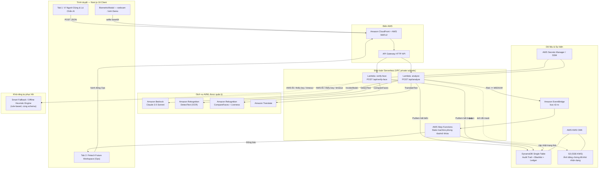
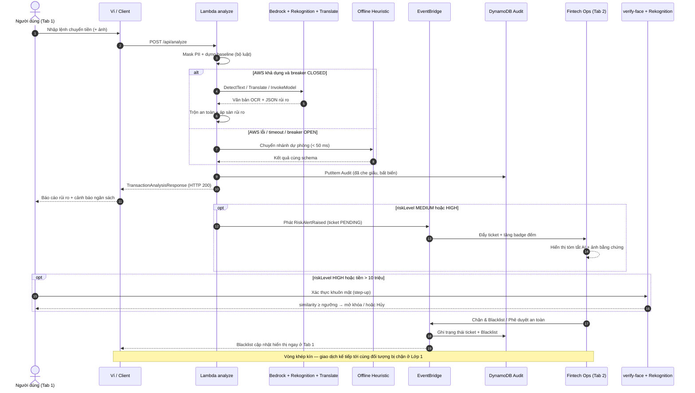
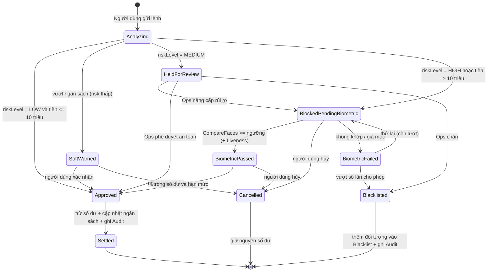

# TrustPay AI — Thiết kế Kiến trúc (Design Specification)

> **Phiên bản:** 1.0 · **Ngày:** 22/11/2026 · **Gắn với:** `requirements.md` (REQ-*), `tasks.md` (T-*)
> **Nguyên tắc nền:** Hợp đồng dữ liệu bất biến (`types/trustpay.ts`) · Serverless-first · Resilient-by-design (Offline Fallback) · Zero-Trust · Tuân thủ NHNN & Nghị định 13.

---

## 1. Tổng quan kiến trúc

TrustPay AI là ứng dụng Next.js 16 (App Router) với 2 Route Handler serverless (`/api/analyze`, `/api/verify-face`) đóng vai trò **biên AI**. Ở MVP Hackathon, hai handler này chạy trong tiến trình Next.js và tự suy giảm sang **Smart Fallback Engine** khi không có AWS. Ở Production, cùng mã nguồn đó được đóng gói thành AWS Lambda sau API Gateway HTTP API, bổ sung Step Functions điều phối phong tỏa/mở khóa, DynamoDB Single-Table lưu vết, và EventBridge đồng bộ sự kiện.

Thiết kế tuân thủ 4 thuộc tính kiến trúc:

| Thuộc tính | Cơ chế | Yêu cầu liên quan |
|---|---|---|
| **Luôn sẵn sàng** | Mọi lệnh gọi AWS bọc trong `try/catch` + ngân sách thời gian + Circuit Breaker; nhánh dự phòng trả cùng schema, HTTP 200 | REQ-A9 |
| **An toàn hợp đồng** | Đầu ra AI được trộn với baseline của bộ luật trước khi trả về; kiểm tra schema | REQ-A9.3, REQ-X1 |
| **Zero-Trust** | IAM least-privilege, bí mật qua `process.env`/Secrets Manager, coi dữ liệu người dùng và đầu ra AI là không tin cậy | REQ-X2 |
| **Tuân thủ** | Step-up sinh trắc theo ngưỡng pháp lý, che giấu PII, Audit Trail bất biến | REQ-A6, REQ-B3, REQ-B4, REQ-X3 |

### 1.1 Sơ đồ (a) — Kiến trúc tổng thể Cloud-Native



### 1.2 Ánh xạ MVP ⇄ Production

| Khối | MVP Hackathon (hiện tại) | Production (lộ trình `tasks.md`) |
|---|---|---|
| Biên | Next.js route handler trong tiến trình | CloudFront + WAFv2 + API Gateway HTTP API |
| Điện toán | Hàm `POST` của route | Lambda (Node 20) đóng gói cùng mã lõi |
| Điều phối | Logic tuần tự trong handler | Step Functions Express cho luồng rủi ro cao |
| Trạng thái chung | React state trong `app/page.tsx` | DynamoDB + EventBridge + WebSocket/AppSync |
| Bí mật | `process.env` cục bộ / `.env.local` | Secrets Manager + IAM Role |
| Dự phòng | Smart Fallback Engine | Cùng engine, chạy khi Circuit Breaker mở |

---

## 2. Thiết kế thành phần

### 2.1 Lá Chắn AI — `/api/analyze`

Luồng xử lý giữ nguyên hành vi hiện có và bổ sung các lớp Production (được đánh dấu *P*):

1. Phân giải body an toàn → mặc định `DEFAULT_BUDGETS`/`DEFAULT_BLACKLIST` khi thiếu (REQ-A1.6, A1.7).
2. *P* Khử nhận dạng đầu vào: che số CCCD trong `commandText` trước mọi xử lý (REQ-X3.5) — `lib/security/pii-masking.ts`.
3. Nếu có ảnh: Rekognition `DetectText` (ngân sách 2,5 s, Circuit Breaker) → ghép dòng `LINE` (REQ-A2.1).
4. Translate `auto → vi` (ngân sách 1,5 s, không chặn luồng) (REQ-A2, A9.2).
5. Dựng **baseline** bằng `buildSmartFallbackAnalysis` (bộ luật xác định).
6. Bedrock `InvokeModel` Claude 3.5 Sonnet (ngân sách 4 s) với prompt kèm baseline tham chiếu.
7. **Trộn an toàn**: lấy JSON từ đầu ra AI, điền khuyết bằng baseline; *P* áp **sàn rủi ro** — không cho AI hạ `riskScore`/`riskLevel` thấp hơn mức bộ luật tính ra (REQ-A3.8) — `lib/security/ai-output-guard.ts`.
8. *P* Quyết định step-up sinh trắc theo **chính sách pháp lý** (`lib/compliance/biometric-policy.ts`): `HIGH` **hoặc** số tiền > 10 triệu **hoặc** luỹ kế ngày > 20 triệu (REQ-A6).
9. *P* Ghi Audit Trail đã che giấu (REQ-B4); phát sự kiện nếu rủi ro ≥ MEDIUM (REQ-B2.5).
10. Trả `TransactionAnalysisResponse` HTTP 200.

> Mọi bước 3–9 lỗi đều rơi về baseline bước 5 và vẫn trả HTTP 200 (REQ-A9).

### 2.2 Chuẩn hóa cấu trúc JSON từ Bedrock

Prompt yêu cầu Claude trả **duy nhất** một JSON `TransactionAnalysisResponse`. Vì LLM có thể thêm văn bản thừa hoặc thiếu trường, handler áp dụng hợp đồng chặt:

```
aiText → trích {…} bằng regex cân bằng → JSON.parse (try/catch)
       → với từng trường: dùng giá trị AI nếu đúng kiểu, ngược lại lấy baseline
       → áp sàn rủi ro (max của AI và bộ luật)
       → tính lại requireBiometric theo biometric-policy (không tin AI)
```

Nguyên tắc: **AI đề xuất, bộ luật quyết định các bất biến an toàn** (mức rủi ro tối thiểu, step-up sinh trắc, che PII). Đây là tuyến phòng thủ chính chống prompt injection (xem `architecture/threat-modeling-stride-atlas.md`).

### 2.3 Xác thực khuôn mặt — `/api/verify-face`

| Khía cạnh | MVP | Production |
|---|---|---|
| So khớp | selfie ↔ selfie (demo) | selfie ↔ ảnh tham chiếu eKYC trong S3/Rekognition Collection |
| Ngưỡng | `similarity ≥ 80` | `≥ 90` + Face Liveness chống giả mạo |
| Khi lỗi/rỗng | Demo Mode `matched = true` | **fail-closed** `matched = false` + hướng dẫn chụp lại |
| Selfie | chỉ trong RAM | chỉ trong RAM, không log, không lưu (REQ-A7.7) |

Cờ `TRUSTPAY_DEMO_MODE` phân tách rõ hai chế độ; Production bắt buộc `TRUSTPAY_DEMO_MODE=false`.

### 2.4 Circuit Breaker & Graceful Degradation

`lib/resilience/circuit-breaker.ts` cung cấp breaker 3 trạng thái cho từng dịch vụ AWS:

- **CLOSED**: gọi bình thường; đếm lỗi liên tiếp.
- **OPEN**: sau N lỗi (mặc định 5) → mở; mọi lệnh gọi đi thẳng fallback trong `coolDownMs` (mặc định 30 s).
- **HALF_OPEN**: hết cooldown → cho 1 lệnh thử; thành công thì đóng lại, thất bại thì mở tiếp.

Kết hợp `withTimeout(promise, budgetMs)` để ép ngân sách thời gian. Khi breaker OPEN, chuyển sang Offline Heuristic trong **< 50 ms** (không chờ mạng) — xem `architecture/disaster-recovery-runbook.md`.

---

## 3. Mô hình dữ liệu DynamoDB Single-Table

Một bảng `TrustPayCore` phục vụ nhiều loại thực thể qua khóa chính tổng hợp.

| Thực thể | PK | SK | Thuộc tính chính | Ghi chú |
|---|---|---|---|---|
| Audit — phân tích | `TXN#<txnId>` | `ANALYSIS#<ts>` | riskLevel, riskScore, amountBucket, recipientMasked, cmdHash | Bất biến, `attribute_not_exists` |
| Audit — xác thực | `TXN#<txnId>` | `BIOMETRIC#<ts>` | matched, similarityBucket | Không lưu ảnh |
| Ticket Ops | `TICKET#<ticketId>` | `STATE#<ts>` | status, riskLevel, amount, recipientMasked | Lịch sử chuyển trạng thái |
| Blacklist | `BLACKLIST#<hashKey>` | `META` | type (STK/NAME), addedBy, reason | `hashKey` = chuẩn hóa |
| Ledger ngày | `USER#<userId>` | `DAILY#<yyyymmdd>` | totalTransferred | Phục vụ ngưỡng 20 triệu/ngày |
| Idempotency | `IDEMP#<key>` | `LOCK` | expiresAt (TTL) | Chống replay/nhân đôi |

**GSI1** (`GSI1PK = STATUS#<status>`, `GSI1SK = <ts>`) để Ops truy vấn hàng đợi theo trạng thái. **TTL** trên thuộc tính `expiresAt` cho bản ghi tạm (idempotency, phiên). Bật **PITR**, mã hóa **KMS CMK**, chế độ **on-demand** để co giãn tới 1 triệu người dùng (REQ-X4.2).

---

## 4. Sơ đồ (b) — Sequence: đồng bộ cảnh báo rủi ro 2 chiều Ví ⇄ Ops



---

## 5. Sơ đồ (c) — State Machine phong tỏa/mở khóa giao dịch



**Bất biến trạng thái:** chỉ `Approved` và `BiometricPassed` mới dẫn tới `Settled`; `BlockedPendingBiometric` không thể tới thẳng `Settled` nếu chưa qua `BiometricPassed` (REQ-A6.1, A6.6). `Blacklisted` luôn kéo theo cập nhật Blacklist và Audit (REQ-A4.2, B2.1).

---

## 6. Thiết kế khả năng mở rộng tới 1 triệu người dùng đồng thời

| Nút thắt | Rủi ro | Giải pháp thiết kế | Yêu cầu |
|---|---|---|---|
| Hạn mức Bedrock | Throttling ở đỉnh | Ưu tiên theo giá trị giao dịch; giao dịch nhỏ dùng bộ luật; cache prompt; retry có jitter | REQ-X4.3, A9 |
| Đọc Blacklist nóng | Đọc lặp lại | Cache in-memory + DAX/ElastiCache, nạp lại theo sự kiện EventBridge | REQ-X4.2 |
| Ghi Audit | Điểm nóng phân mảnh | PK phân tán theo `txnId` (ngẫu nhiên cao); on-demand | §3 |
| Cold start Lambda | Độ trễ đuôi | Provisioned Concurrency cho giờ cao điểm; gói phụ thuộc gọn | REQ-X4.1 |
| Fan-out realtime tới Ops | Kết nối lớn | AppSync Subscriptions/WebSocket phân tầng theo nhóm Ops | REQ-B1 |

---

## 7. Che giấu PII & bảo vệ dữ liệu cá nhân (LG-03, LG-04)

Quy tắc masking tập trung tại `lib/security/pii-masking.ts`, áp dụng trước khi dữ liệu rời biên tin cậy (log, Audit, giao diện Ops, prompt LLM):

| Loại dữ liệu | Quy tắc | Ví dụ |
|---|---|---|
| CCCD 12 chữ số | giữ 3 đầu + 3 cuối, thay giữa bằng `*` | `001******567` |
| Số điện thoại | giữ 4 cuối | `*******1234` |
| STK 6–19 chữ số | giữ 2 đầu + 3 cuối | `19****999` |
| Ảnh selfie | không log, không lưu | — |
| Ảnh bằng chứng | làm mờ vùng CCCD/khuôn mặt, lưu S3 SSE-KMS | — |
| Văn bản lệnh thô | chỉ lưu `SHA-256` để đối chiếu | `cmdHash` |

Dữ liệu AI gọi ở region `ap-southeast-1` (Singapore) khi cần lưu trú gần Việt Nam; hồ sơ chuyển dữ liệu ra nước ngoài theo Nghị định 13 (xem `compliance/decree-13-dpia-report.md`).

---

## 8. Quyết định thiết kế (ADR tóm tắt)

| # | Quyết định | Lý do | Đánh đổi |
|---|---|---|---|
| ADR-1 | Bộ luật quyết định bất biến an toàn, AI chỉ làm giàu | Chống prompt injection, bảo đảm xác định | AI không thể hạ rủi ro kể cả khi đúng |
| ADR-2 | Fallback trả HTTP 200 cùng schema | UI không bao giờ vỡ khi demo/mất mạng | Client phải đọc `riskLevel` thay vì mã lỗi |
| ADR-3 | DynamoDB Single-Table | Độ trễ thấp, co giãn, chi phí theo dùng | Mô hình truy vấn phải thiết kế trước |
| ADR-4 | Step-up sinh trắc theo chính sách tập trung | Tuân thủ QĐ 2345/TT 50 nhất quán | Thêm một điểm cấu hình ngưỡng |
| ADR-5 | CDK multi-stack (serverless/network/observability) | Tách vòng đời, phân quyền triển khai | Nhiều stack hơn để quản lý |
| ADR-6 | `verify-face` fail-closed ở Production | An toàn > tiện lợi cho giao dịch rủi ro | Cần đường dẫn hỗ trợ khi khuôn mặt lỗi |

---

## 9. Phụ thuộc hợp đồng với `API_CONTRACT.md`

Thiết kế này **không** thay đổi `types/trustpay.ts` hay cấu trúc JSON trong `API_CONTRACT.md`. Mọi trường Production bổ sung (Audit, Ledger, correlationId) nằm ở tầng hạ tầng/nhật ký, **không** chèn vào response hợp đồng. Mọi thay đổi hợp đồng trong tương lai phải qua quy trình có phiên bản (REQ-X1.2) và được hook `api-contract-sync` kiểm tra tự động (REQ-X1.3).
