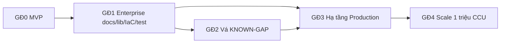

# TrustPay AI — Phân rã Công việc (WBS & Implementation Plan)

> **Phiên bản:** 1.0 · **Ngày:** 22/11/2026 · **Gắn với:** `requirements.md` (REQ-*), `design.md` (ADR/§)
> Mỗi task ghi rõ đầu ra, yêu cầu được thỏa và tiêu chí hoàn thành (DoD). Các task MVP đã có trong mã nguồn hiện tại được đánh dấu `[x]`.

## Quy ước mức độ

- `[x]` đã hoàn thành trong mã nguồn hiện tại · `[ ]` chưa làm.
- **KNOWN-GAP**: khoảng trống đã biết, được bộ kiểm thử `tests/` phát hiện; có task khắc phục ở Giai đoạn 2 nhưng **không** sửa trong phạm vi an toàn của gói hiện tại (giữ nguyên hành vi Offline Fallback & giao diện).

---

## Giai đoạn 0 — MVP Hackathon (Baseline hiện có)

- [x] **T-0.1** Hợp đồng dữ liệu `types/trustpay.ts` + `API_CONTRACT.md` _(REQ-X1)_
- [x] **T-0.2** `/api/analyze` với Bedrock + Rekognition DetectText + Translate và Smart Fallback Engine _(REQ-A1, A2, A3, A9)_
- [x] **T-0.3** `/api/verify-face` với Rekognition CompareFaces + Demo Mode _(REQ-A7)_
- [x] **T-0.4** Tab 1 Ví: nhập lệnh, báo cáo Lá chắn, ngân sách, 4 kịch bản demo _(REQ-A1, A5, A8)_
- [x] **T-0.5** BiometricModal: webcam thật + ảnh Demo _(REQ-A6.6, A7.5)_
- [x] **T-0.6** Tab 2 Ops: hàng đợi ticket, KPI, lọc, chặn/duyệt, đồng bộ Blacklist 2 chiều _(REQ-B1, B2)_
- [x] **T-0.7** Reset dữ liệu Demo + Toast realtime _(REQ-A8.2)_

**DoD Giai đoạn 0:** 4 kịch bản demo chạy đúng, `npx tsc --noEmit` và `npm run build` sạch, hoạt động không cần AWS.

---

## Giai đoạn 1 — Chuẩn hóa Enterprise (gói công việc này, không phá vỡ MVP)

### 1.1 Đặc tả & quản trị
- [x] **T-1.1** Bộ đặc tả `.kiro/specs/trustpay-ai/` (`requirements.md`, `design.md`, `tasks.md`)
- [x] **T-1.2** Steering `fintech-architecture-guardrails.md` và `aws-resilience-and-finops.md`
- [x] **T-1.3** 4 Kiro Hooks: verify-types-on-save, api-contract-sync, fintech-pii-security-guard, biometric-threshold-audit

### 1.2 Thư viện chính sách dùng chung (thuần TS, strict, không phụ thuộc ngoài)
- [x] **T-1.4** `lib/compliance/biometric-policy.ts` — quyết định step-up theo ngưỡng pháp lý _(REQ-A6)_
- [x] **T-1.5** `lib/resilience/circuit-breaker.ts` — breaker 3 trạng thái + `withTimeout` _(REQ-A9.4, A9.5)_
- [x] **T-1.6** `lib/security/pii-masking.ts` — che CCCD/SĐT/STK _(REQ-X3, B3.2)_
- [x] **T-1.7** `lib/security/ai-output-guard.ts` — sàn rủi ro + kiểm tra schema đầu ra AI _(REQ-A3.8, A9.3)_

### 1.3 Hạ tầng IaC (AWS CDK, tách khỏi build Next.js)
- [x] **T-1.8** `infra/trustpay-serverless-stack.ts` — API GW HTTP API, Lambda analyze/verify-face, DynamoDB Audit, IAM least-privilege _(REQ-X2.2, B4)_
- [x] **T-1.9** `infra/lib/network-security-stack.ts` — VPC isolated, VPC Endpoints, WAFv2, KMS CMK _(REQ-X2.6)_
- [x] **T-1.10** `infra/lib/observability-finops-stack.ts` — CloudWatch Dashboards, Alarms, X-Ray, Budgets _(REQ-X5)_
- [x] **T-1.11** `infra/README.md` — hướng dẫn `cdk deploy`

### 1.4 Kiểm thử & tài liệu
- [x] **T-1.12** `tests/fraud-adversarial-suite.ts` — 15 kịch bản lừa đảo + fallback _(REQ-A3, A9)_
- [x] **T-1.13** `tests/prompt-injection-jailbreak-suite.ts` — 20 kịch bản injection/jailbreak _(REQ-A3.8, X2.3)_
- [x] **T-1.14** `tests/concurrency-benchmark-suite.ts` — đo P50/P95/P99 ở 500 TPS _(REQ-X4)_
- [x] **T-1.15** Mô hình đe dọa STRIDE/ATLAS + Runbook DR _(architecture/)_
- [x] **T-1.16** Hồ sơ tuân thủ NHNN + DPIA Nghị định 13 _(compliance/)_
- [x] **T-1.17** README whitepaper + hồ sơ phản biện giám khảo _(pitch-prep/)_

**DoD Giai đoạn 1:** toàn bộ `.ts` mới biên dịch sạch với `tsconfig.json` chính; `infra/` được loại khỏi build Next.js; bộ test chạy được không cần AWS; không chạm `docs/`, `app/page.tsx`, `components/`, chữ ký `types/trustpay.ts`.

---

## Giai đoạn 2 — Vá KNOWN-GAP & nối hạ tầng thật

> Các task sửa vào `app/api/*` và thêm trạng thái máy chủ; thực hiện ngoài phạm vi an toàn hiện tại, có cờ tính năng để không ảnh hưởng demo.

- [ ] **T-2.1** Áp `biometric-policy` trong `/api/analyze` để bắt step-up cho giao dịch > 10 triệu kể cả khi `LOW` _(REQ-A6.2 · KNOWN-GAP G1)_
- [ ] **T-2.2** `verify-face` fail-closed khi `FaceMatches` rỗng/lỗi ở Production; tách Demo Mode qua cờ _(REQ-A7.3, A7.4 · G2, G3)_
- [ ] **T-2.3** Áp `ai-output-guard` sàn rủi ro trong bước trộn Bedrock _(REQ-A3.8 · G6)_
- [ ] **T-2.4** Mở rộng bộ luật: cài app lạ/VNeID giả, QR đè, việc nhẹ lương cao, hóa đơn giả _(REQ-A2.5, A3.5, A3.6)_
- [ ] **T-2.5** Chuẩn hóa khóa Blacklist (STK tách khỏi tên) _(REQ-A4.3 · G5)_
- [ ] **T-2.6** Bọc lệnh gọi AWS bằng `circuit-breaker` + `withTimeout` _(REQ-A9.4, A9.5 · G7)_
- [ ] **T-2.7** Che CCCD trong `recipient`/`summary`/prompt _(REQ-X3.5, B3.2 · G8)_
- [ ] **T-2.8** Giới hạn & vệ sinh độ dài `commandText`/OCR trước khi vào prompt _(REQ-X2.3 · G9)_
- [ ] **T-2.9** Chuẩn hóa Unicode (NFD, bỏ zero-width, chống homoglyph) trước khi dò từ khóa _(G10)_
- [ ] **T-2.10** Ledger ngày trên DynamoDB cho ngưỡng 20 triệu/ngày _(REQ-A6.4)_
- [ ] **T-2.11** Ràng buộc thiết bị tin cậy + step-up thiết bị mới _(REQ-A6.5)_

---

## Giai đoạn 3 — Hạ tầng Production & tuân thủ

- [ ] **T-3.1** Triển khai 3 stack CDK lên `ap-southeast-1`; bật PITR/KMS/TTL _(REQ-B4.4, X3)_
- [ ] **T-3.2** Step Functions Express cho luồng phong tỏa/mở khóa _(design §5)_
- [ ] **T-3.3** EventBridge bus + AppSync subscription realtime Ops _(REQ-B2.5, B1)_
- [ ] **T-3.4** Rekognition Collection (ảnh eKYC tham chiếu) + Face Liveness _(REQ-A7.1, A7.6)_
- [ ] **T-3.5** S3 lưu ảnh bằng chứng đã khử nhận dạng + URL ký hết hạn ≤ 5 phút _(REQ-B3.3)_
- [ ] **T-3.6** SSO + MFA + RBAC cho Ops (`fraud-analyst`/`fraud-lead`/`auditor`) _(REQ-B5.1)_
- [ ] **T-3.7** Phê duyệt 4 mắt khi gỡ Blacklist _(REQ-B5.2)_
- [ ] **T-3.8** Hồ sơ DPIA ký duyệt + quy trình thông báo vi phạm 72 giờ _(REQ-X3.3, X3.4)_

---

## Giai đoạn 4 — Mở rộng quy mô 1 triệu người dùng đồng thời

- [ ] **T-4.1** Provisioned Concurrency + cân tải theo giá trị giao dịch _(REQ-X4.1, X4.3)_
- [ ] **T-4.2** Cache Blacklist (DAX/ElastiCache) nạp lại theo sự kiện _(REQ-X4.2)_
- [ ] **T-4.3** Bedrock Guardrails + Knowledge Base kịch bản lừa đảo mới _(REQ-A3)_
- [ ] **T-4.4** Prompt caching + định tuyến mô hình (Haiku cho giao dịch nhỏ, Sonnet cho rủi ro cao) _(FinOps)_
- [ ] **T-4.5** Diễn tập tải 20.000 RPS; tinh chỉnh theo P99 _(REQ-X4.2)_
- [ ] **T-4.6** Chaos test: đứt Bedrock/Rekognition, đo tỷ lệ & thời gian chuyển fallback _(REQ-A9 · runbook DR)_
- [ ] **T-4.7** Multi-AZ/đa region dự phòng; diễn tập chuyển vùng _(DR)_

---

## Phụ thuộc & đường găng

**Đường găng:** T-1.8/1.9/1.10 (IaC) → T-3.1 (deploy) → T-3.2/3.3 (điều phối realtime) → T-4.1/4.5 (scale). Các task vá KNOWN-GAP (T-2.x) chạy song song với hạ tầng vì chúng chỉ sửa tầng ứng dụng.
