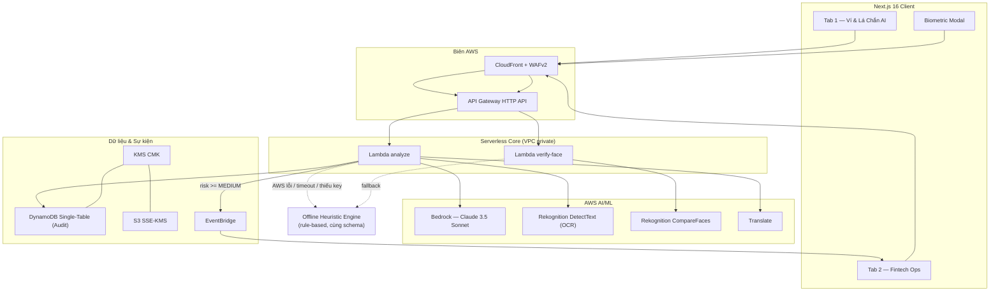

<div align="center">

# 🛡️ TrustPay AI

### Ví thanh toán thông minh với Lá Chắn AI chống lừa đảo thời gian thực

**Technical Whitepaper — MoMo TechDay 2026**

Mỗi lệnh chuyển tiền đều được AI "soát vé" trước khi tiền rời ví.

`Next.js 16` · `AWS Bedrock (Claude 3.5 Sonnet)` · `Amazon Rekognition` · `Amazon Translate` · `AWS Serverless` · `Kiro`

</div>

---

## 1. Tóm tắt điều hành

**Bài toán.** Khoảnh khắc nguy hiểm nhất với người dùng ví điện tử là ngay *trước* khi bấm "Chuyển tiền": nạn nhân bị dẫn dụ bởi kịch bản mạo danh công an, bẫy "trúng thưởng/nộp phí", hóa đơn giả, mã QR đè — và tự tay chuyển tiền. Các hệ thống hiện nay phần lớn cảnh báo *sau* giao dịch; người dùng và đội vận hành (Ops) không nhìn thấy cùng một dữ liệu tại cùng thời điểm.

**Giải pháp.** TrustPay AI đặt một **Lá Chắn AI** giữa người dùng và nút chuyển tiền, với 2 lớp bảo vệ chạy *trước* giao dịch:

- **Lớp 1 — Chống lừa đảo:** bóc tách lệnh bằng ngôn ngữ tự nhiên (+ OCR ảnh), đối chiếu Blacklist, chấm `riskScore` 0–100, nhận diện kịch bản lừa đảo, giải thích dễ hiểu. Rủi ro CAO → khóa nút chuyển, **bắt buộc xác thực khuôn mặt**.
- **Lớp 2 — Trợ lý ngân sách:** tự phân loại 4 danh mục, cảnh báo vượt hạn mức, gợi ý hành động.

Giao dịch rủi ro được **đồng bộ 2 chiều thời gian thực** sang **Fintech Future Workspace (Ops)**; quyết định của Ops quay ngược lại làm giàu Blacklist cho Ví — tạo vòng khép kín chống lừa đảo.

**Điểm kỹ thuật nổi bật.**
- **Resilient-by-design:** mọi lệnh gọi AWS có `try/catch` + ngân sách thời gian + Circuit Breaker; mất AWS vẫn **luôn trả HTTP 200 đúng hợp đồng** nhờ Offline Heuristic Engine (< 50 ms).
- **An toàn trước AI:** "AI đề xuất, bộ luật quyết định bất biến" — sàn rủi ro chống Prompt Injection; đầu ra LLM luôn được trộn với baseline và kiểm tra kiểu.
- **Tuân thủ từ gốc:** step-up sinh trắc theo QĐ 2345/TT 50; che giấu PII theo Nghị định 13; Audit Trail bất biến.

---

## 2. Kiến trúc tổng thể (Cloud-Native)



> Chi tiết 3 sơ đồ (kiến trúc, sequence đồng bộ 2 chiều, state machine phong tỏa/mở khóa): xem `/.kiro/specs/trustpay-ai/design.md`.

---

## 3. Ma trận công nghệ AWS & Kiro

| Công nghệ | Vai trò trong TrustPay AI | Vị trí |
|---|---|---|
| **AWS Bedrock — Claude 3.5 Sonnet** | Bộ não phân tích rủi ro; trả JSON `TransactionAnalysisResponse` | `app/api/analyze` |
| **Amazon Rekognition — DetectText** | OCR ảnh hóa đơn/tin nhắn nghi vấn | `app/api/analyze` |
| **Amazon Rekognition — CompareFaces** | Xác thực sinh trắc học giao dịch rủi ro cao | `app/api/verify-face` |
| **Amazon Translate** | Chuẩn hóa nội dung đa ngôn ngữ trước phân tích | `app/api/analyze` |
| **API Gateway HTTP API** | Biên serverless cho 2 route | `infra/` |
| **AWS Lambda** | Điện toán không máy chủ, tự co giãn | `infra/lambda/` |
| **DynamoDB Single-Table** | Audit Trail bất biến, Blacklist, Ledger | `infra/` |
| **AWS KMS / WAFv2 / VPC Endpoints** | Mã hóa, chống bot/DDoS, cô lập mạng (Zero-Trust) | `infra/lib/network-security-stack.ts` |
| **CloudWatch / X-Ray / Budgets** | Quan sát P99, anomaly, chi phí | `infra/lib/observability-finops-stack.ts` |
| **Kiro — Specs** | Đặc tả EARS + thiết kế + WBS | `.kiro/specs/trustpay-ai/` |
| **Kiro — Hooks** | Tự động kiểm kiểu, đồng bộ hợp đồng, canh PII & ngưỡng pháp lý | `.kiro/hooks/` |
| **Kiro — Steering** | Luật kiến trúc, Zero-Trust, FinOps cho AI Agent | `.kiro/steering/` |

---

## 4. Trải nghiệm Demo 1-click trong 60 giây

```bash
npm install
npm run dev
# Mở http://localhost:3000
```

1. **Đăng nhập nhanh** — bấm "Đăng nhập nhanh bằng Tài khoản Demo" (không cần mật khẩu, số dư 15.000.000đ).
2. **Chọn 1 trong 4 kịch bản** ở Tab 1 (hoặc tự gõ lệnh/tải ảnh):
   - *An toàn:* "Chuyển 45.000đ tiền bún bò cho Quán Cô Ba" → LOW, cho chuyển ngay.
   - *Vượt ngân sách:* "Thanh toán 2.500.000đ mua giày sneaker tại Shop XYZ" → nhắc nhở.
   - *Mạo danh & Blacklist:* "Chuyển gấp 12.000.000đ cho Cán bộ điều tra STK 999988887777..." → HIGH 95 → **FaceID** → ticket sang Ops.
   - *Bẫy trúng thưởng:* "Chuyển 3.000.000đ phí nhận thưởng iPhone 16 Pro Max..." → HIGH 88 → **FaceID**.
3. **Xác thực khuôn mặt** (webcam thật hoặc "Dùng ảnh Demo") cho giao dịch rủi ro cao.
4. **Sang Tab 2 (Fintech Ops)** xem ticket đồng bộ, bấm "Chặn & Thêm vào Blacklist" → Blacklist cập nhật ngay ở Tab 1.
5. **Reset dữ liệu Demo** để diễn lại.

> Không cần AWS credentials: hệ thống tự chạy **Offline Fallback** đúng hợp đồng. Khi có credentials, các API gọi AWS thật.

### Kiểm thử & kiểm tra kiểu

```bash
npm run typecheck      # tsc --noEmit — 0 lỗi
npm run test:fraud     # 15 kịch bản lừa đảo + tự phục hồi
npm run test:injection # 20 kịch bản Prompt Injection / Jailbreak
npm run test:bench     # Benchmark P50/P95/P99 ở 500 TPS
```

---

## 5. Cấu trúc thư mục

```
trustpay-ai/
├─ app/                      # Next.js App Router
│  ├─ api/analyze/route.ts   # Lá Chắn AI (Bedrock + Rekognition + Translate + Fallback)
│  ├─ api/verify-face/route.ts
│  ├─ layout.tsx · page.tsx  # Giao diện 2 tab (Ví & Ops)
├─ components/               # UI (WalletSidebar, AiShieldResultPanel, FraudOpsDashboard, BiometricModal...)
├─ lib/
│  ├─ mock-scenarios.ts
│  ├─ compliance/biometric-policy.ts     # Ngưỡng QĐ2345/TT50
│  ├─ resilience/circuit-breaker.ts       # Breaker + timeout
│  └─ security/{pii-masking,ai-output-guard}.ts
├─ types/trustpay.ts         # Hợp đồng dữ liệu (nguồn sự thật)
├─ infra/                    # AWS CDK (dự án TS độc lập, ngoài build Next.js)
│  ├─ trustpay-serverless-stack.ts
│  ├─ lib/{network-security,observability-finops}-stack.ts
│  └─ lambda/{analyze,verify-face,heuristic}.ts
├─ tests/                    # fraud / injection / concurrency suites
├─ architecture/            # STRIDE × ATLAS, DR runbook
├─ compliance/              # Ma trận NHNN, DPIA Nghị định 13
├─ pitch-prep/              # Unit economics, Q&A CTO/CISO
├─ docs/                    # Pitch deck, kịch bản demo, user guide
└─ .kiro/
   ├─ specs/trustpay-ai/    # requirements · design · tasks
   ├─ hooks/                # verify-types, api-contract-sync, pii-guard, biometric-threshold
   └─ steering/             # rules, fintech-guardrails, aws-resilience-finops
```

---

## 6. Cấu hình biến môi trường

Tạo `.env.local` (không commit). Thiếu biến AWS → tự chạy Offline Fallback.

| Biến | Bắt buộc | Mặc định | Ý nghĩa |
|---|---|---|---|
| `AWS_ACCESS_KEY_ID` | Khi dùng AWS | — | Khóa truy cập AWS |
| `AWS_SECRET_ACCESS_KEY` | Khi dùng AWS | — | Khóa bí mật AWS |
| `AWS_SESSION_TOKEN` | Tùy chọn | — | Token phiên (STS) |
| `AWS_REGION` | Tùy chọn | `us-east-1` | Region gọi dịch vụ |
| `BEDROCK_MODEL_ID` | Tùy chọn | `anthropic.claude-3-5-sonnet-20240620-v1:0` | Model Bedrock |
| `AWS_S3_BUCKET_NAME` | Tùy chọn | — | Bucket lưu tài sản (Production) |
| `BIOMETRIC_SINGLE_TXN_THRESHOLD_VND` | Tùy chọn | `10000000` | Ngưỡng sinh trắc/lần (QĐ 2345) |
| `BIOMETRIC_DAILY_CUMULATIVE_THRESHOLD_VND` | Tùy chọn | `20000000` | Ngưỡng sinh trắc lũy kế/ngày |
| `FACE_SIMILARITY_THRESHOLD` | Tùy chọn | `80` (Demo) / `90` (Prod) | Ngưỡng độ khớp khuôn mặt |
| `TRUSTPAY_DEMO_MODE` | Tùy chọn | `true` (local) | `false` ở Production (fail-closed) |

> **Bảo mật:** tuyệt đối không hardcode khóa AWS trong mã nguồn. Hook `fintech-pii-security-guard` sẽ chặn thao tác ghi chứa mẫu khóa `AKIA…/ASIA…` hoặc log dữ liệu nhạy cảm.

---

## 7. Nguyên tắc thiết kế cốt lõi

1. **Hợp đồng dữ liệu bất biến** (`types/trustpay.ts`) — mọi thành phần import cùng một nguồn kiểu.
2. **AI đề xuất, bộ luật quyết định** — sàn rủi ro chống injection, đảm bảo luôn có phán quyết an toàn.
3. **Suy giảm duyên dáng** — Offline Fallback < 50 ms, không bao giờ làm vỡ UI.
4. **Zero-Trust & tuân thủ** — least-privilege, mã hóa KMS, che giấu PII, step-up sinh trắc theo luật NHNN.

---

<div align="center">

**TrustPay AI** — *Lá chắn chống lừa đảo + Trợ lý ngân sách + Workspace cho Ops, trong cùng một luồng thời gian thực.*

Tài liệu kèm theo: `docs/PITCH_DECK.md` · `docs/DEMO_VIDEO_SCRIPT.md` · `docs/USER_GUIDE_A4.md`

</div>
