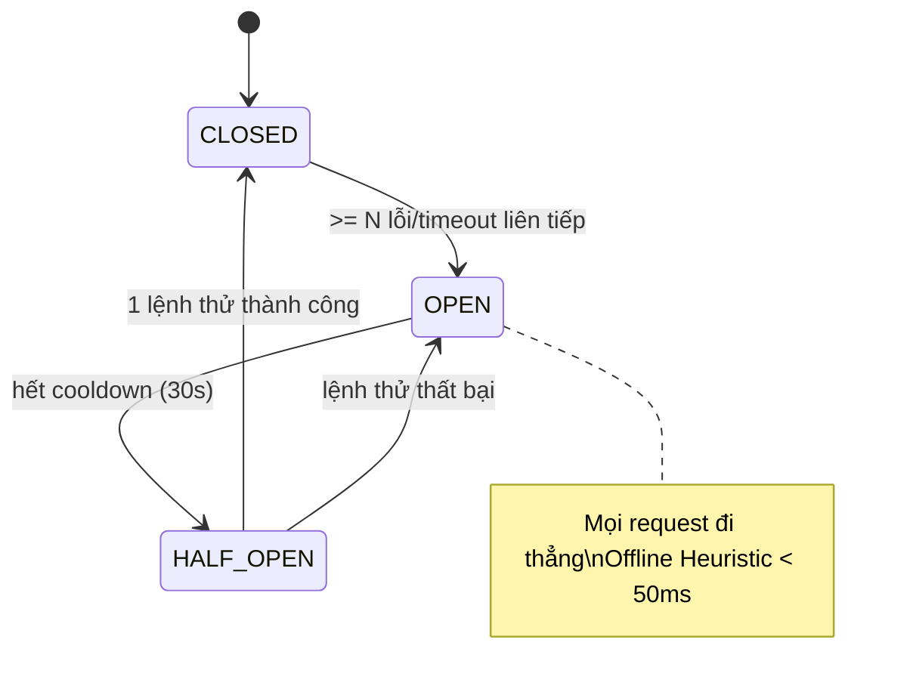

# TrustPay AI — Runbook Ứng phó Sự cố & Phục hồi (DR)

> **Phiên bản:** 1.0 · **Ngày:** 22/11/2026 · **Đối tượng:** kỹ sư trực ca (on-call), SRE, đội Fintech Ops.
> **Nguyên tắc vàng:** TrustPay AI **luôn trả HTTP 200 đúng hợp đồng**. Khi AWS suy giảm, hệ thống tự chuyển sang **Offline Heuristic Engine** (bộ luật xác định) — người dùng vẫn được bảo vệ, demo không gián đoạn.

## 1. Mục tiêu phục hồi

| Chỉ số | Mục tiêu |
|---|---|
| RTO (thời gian phục hồi) cho đường phân tích | 0 giây gián đoạn người dùng (tự suy giảm) |
| Thời gian chuyển sang Offline Heuristic | **< 50 ms** (không chờ mạng khi breaker OPEN) |
| RPO (mất dữ liệu) Audit Trail | ≈ 0 (DynamoDB PITR) |
| p99 phản hồi `/api/analyze` khi suy giảm | ≤ 300 ms (nhánh bộ luật) |

## 2. Cơ chế tự phục hồi (đã hiện thực trong mã)

- `lib/resilience/circuit-breaker.ts`: breaker 3 trạng thái cho từng dịch vụ AWS + `withTimeout` ép ngân sách thời gian (Bedrock 4s, Rekognition 2.5s, Translate 1.5s).
- `app/api/analyze/route.ts` + `infra/lambda/analyze.ts`: mọi lệnh gọi AWS bọc `try/catch`; lỗi/timeout → baseline bộ luật; thiếu credentials → Offline ngay.
- `lib/security/ai-output-guard.ts`: nếu Bedrock trả JSON lỗi/thiếu, trộn an toàn với baseline.

**Vì sao < 50 ms:** khi breaker ở trạng thái `OPEN`, `execute()` trả thẳng kết quả fallback **mà không gọi dịch vụ AWS** (kiểm chứng bằng kịch bản F14 trong `tests/fraud-adversarial-suite.ts`: `actionCalled === false`). Nhánh bộ luật thuần CPU, không I/O mạng.

---

## 3. Sự cố 1 — Bedrock `ThrottlingException` / quota cạn

**Triệu chứng:** CloudWatch `FallbackRate` tăng; log có `ThrottlingException`/`TooManyRequestsException`; alarm lỗi hoặc anomaly kích hoạt.

**Tác động:** phân tích vẫn hoạt động bằng bộ luật; chất lượng diễn giải giảm nhẹ (ít câu chữ AI), **mức rủi ro vẫn đúng** nhờ sàn rủi ro.

**Quy trình xử lý:**
1. Xác nhận trên Dashboard `TrustPay-AI-Operations`: `FallbackRate` và P99.
2. Kiểm tra breaker: nếu `OPEN`, hệ thống đã tự bảo vệ — không cần hành động khẩn.
3. Giảm tải Bedrock: tạm bật định tuyến mô hình rẻ (Haiku) cho giao dịch nhỏ; tăng ngưỡng ưu tiên giá trị (REQ-X4.3).
4. Mở ticket tăng quota Bedrock (Service Quotas) nếu kéo dài.
5. Khi throttling hết: breaker tự chuyển `HALF_OPEN → CLOSED`.

**Tiêu chí đóng sự cố:** `FallbackRate` < 5% trong 15 phút; không còn `ThrottlingException`.

---

## 4. Sự cố 2 — Rekognition suy giảm độ chính xác / lỗi

**Triệu chứng:** tỷ lệ `matched=false` bất thường ở `/api/verify-face`, hoặc OCR trả rỗng nhiều.

**Tác động & xử lý:**
- OCR lỗi: `/api/analyze` bỏ qua OCR, phân tích bằng văn bản lệnh (REQ-A2.4) — không ảnh hưởng người dùng.
- CompareFaces lỗi/độ chính xác giảm: **Production giữ fail-closed** (từ chối, yêu cầu chụp lại) để an toàn; **không** tự nới ngưỡng.
  1. Kiểm tra chất lượng ảnh đầu vào (ánh sáng, độ phân giải) qua mẫu log đã ẩn danh.
  2. Nếu lỗi từ dịch vụ: cân nhắc kênh xác thực dự phòng do Pháp chế phê duyệt (ví dụ OTP cứng cho giao dịch trong ngưỡng thấp), **không** hạ ngưỡng sinh trắc cho giao dịch > 10 triệu.
  3. Mở sự cố với AWS nếu lỗi diện rộng.

**Không làm:** tự động nới `FACE_SIMILARITY_THRESHOLD` hoặc bật Demo Mode ở Production để "cho qua".

---

## 5. Sự cố 3 — Mất kết nối khu vực / đứt cáp quang

**Triệu chứng:** timeout diện rộng tới nhiều dịch vụ AWS; breaker nhiều dịch vụ `OPEN`.

**Tác động:** toàn bộ phân tích chạy Offline Heuristic (< 50 ms); xác thực khuôn mặt fail-closed; ticket Ops xếp hàng cục bộ và đồng bộ lại khi kết nối phục hồi.

**Quy trình:**
1. Xác nhận phạm vi qua AWS Health Dashboard.
2. Nếu đứt một AZ: Lambda/endpoint đa AZ tự định tuyến (VPC trải 3 AZ).
3. Nếu mất cả region: kích hoạt kế hoạch đa region (Giai đoạn 4, T-4.7) — chuyển DNS/định tuyến sang region dự phòng đã sao chép (DynamoDB Global Tables, S3 CRR).
4. Thông báo Ops: ưu tiên rà soát thủ công ticket giá trị cao trong thời gian suy giảm.
5. Khi phục hồi: breaker `HALF_OPEN → CLOSED`; đối soát Audit (PITR) và ledger ngày.

---

## 6. Phục hồi dữ liệu

| Dữ liệu | Cơ chế | Thao tác phục hồi |
|---|---|---|
| Audit Trail (DynamoDB) | PITR bật | `aws dynamodb restore-table-to-point-in-time` tới mốc trước sự cố |
| Ảnh bằng chứng (S3) | Versioning + SSE-KMS | Khôi phục phiên bản; CRR nếu bật đa region |
| Khóa KMS | CMK RETAIN | Không xóa; kiểm tra chính sách khóa |
| Cấu hình hạ tầng | CDK (IaC) | `cd infra && npx cdk deploy --all` tái dựng xác định |

## 7. Diễn tập (Game Day) định kỳ

1. **Chaos Bedrock:** chèn lỗi/độ trễ nhân tạo (biến môi trường `AWS_ENDPOINT_URL` trỏ endpoint giả trong staging) → đo thời gian breaker chuyển `OPEN` và `FallbackRate`.
2. **Chaos Rekognition:** mô phỏng lỗi CompareFaces → xác nhận fail-closed.
3. **Tải cao:** chạy `npm run test:bench` với `BENCH_TPS=500` → kiểm P99 nhánh fallback ≤ 300 ms.
4. **Phục hồi Audit:** diễn tập restore PITR trên bảng staging.

**Tần suất:** hằng quý và sau mỗi thay đổi lớn về hạ tầng.

## 8. Liên hệ & leo thang

| Vai trò | Trách nhiệm |
|---|---|
| On-call SRE | Tiếp nhận alarm, xác định phạm vi, áp dụng runbook |
| Tech Lead | Quyết định kích hoạt đa region, phê duyệt thay đổi ngưỡng tạm thời |
| Pháp chế & Tuân thủ | Phê duyệt kênh xác thực dự phòng, đánh giá nghĩa vụ thông báo sự cố (NĐ 13) |
| AWS Support | Quota, sự cố dịch vụ diện rộng |

> **Ghi nhớ:** mục tiêu của DR tại TrustPay AI không phải "chờ AWS phục hồi" mà là **suy giảm duyên dáng tức thì** — người dùng luôn nhận được phán quyết rủi ro an toàn, kể cả khi đám mây ngoại tuyến.
