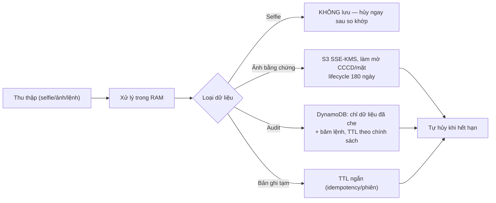

# TrustPay AI — Báo cáo Đánh giá Tác động Xử lý Dữ liệu Cá nhân (DPIA)

> Theo **Nghị định 13/2023/NĐ-CP** về bảo vệ dữ liệu cá nhân (và cập nhật theo Luật Bảo vệ dữ liệu cá nhân 2025, áp dụng mức kiểm soát cao hơn).
> **Phiên bản:** 1.0 (nháp kỹ thuật) · **Ngày:** 22/11/2026 · **Trạng thái:** chờ Pháp chế & DPO phê duyệt.
> **Lưu ý:** Đây là khung DPIA kỹ thuật để triển khai hệ thống; bản DPIA chính thức nộp cơ quan chức năng do DPO/Pháp chế hoàn thiện và ký.

## 1. Thông tin chung

| Mục | Nội dung |
|---|---|
| Bên kiểm soát dữ liệu | Đơn vị vận hành TrustPay AI (ví điện tử) |
| Bên xử lý dữ liệu | AWS (Bedrock, Rekognition, Translate, DynamoDB, S3) — theo thỏa thuận xử lý dữ liệu |
| Mục đích xử lý | Chống lừa đảo giao dịch, xác thực sinh trắc học theo yêu cầu NHNN, kiểm soát ngân sách |
| Cơ sở pháp lý xử lý | Thực hiện nghĩa vụ pháp luật (QĐ 2345/TT 50) + sự đồng ý của chủ thể dữ liệu |
| Khu vực lưu trú dữ liệu | Ưu tiên **AWS ap-southeast-1 (Singapore)**; dữ liệu nhạy cảm xem mục 7 |

## 2. Phân loại dữ liệu cá nhân được xử lý

| Dữ liệu | Phân loại (NĐ 13) | Nguồn | Mục đích |
|---|---|---|---|
| Số CCCD/định danh | Cơ bản | OCR ảnh, văn bản lệnh | Đối chiếu danh tính, phát hiện gian lận |
| Số điện thoại | Cơ bản | Lệnh, hồ sơ | Nhận diện người nhận, cảnh báo |
| Số tài khoản (STK) | Cơ bản (gắn tài chính) | Lệnh, OCR | Đối chiếu Blacklist, phân tích |
| Ảnh khuôn mặt (selfie, ảnh tham chiếu) | **Nhạy cảm (sinh trắc học)** | Webcam, eKYC | Xác thực giao dịch rủi ro cao |
| Dữ liệu giao dịch/chi tiêu | **Nhạy cảm (tài chính)** | Hoạt động ví | Kiểm soát ngân sách, chấm rủi ro |
| Nội dung tin nhắn/hóa đơn | Có thể chứa PII | Ảnh tải lên | Phát hiện kịch bản lừa đảo |

## 3. Nguyên tắc xử lý & biện pháp kỹ thuật

| Nguyên tắc (NĐ 13) | Biện pháp tại TrustPay AI | Thành phần |
|---|---|---|
| **Hợp pháp, minh bạch** | Thu thập sự đồng ý rõ ràng cho sinh trắc học lần đầu; thông báo mục đích | REQ-X3.2 |
| **Hạn chế mục đích** | Dữ liệu chỉ dùng cho chống gian lận & xác thực; không dùng mục đích khác | Chính sách |
| **Tối thiểu hóa** | Chỉ xử lý trường cần thiết; ảnh selfie không lưu; văn bản lệnh chỉ lưu băm SHA-256 | `pii-masking.ts` |
| **Chính xác** | So khớp với ảnh eKYC đã xác minh; ngưỡng độ khớp cấu hình | `verify-face` |
| **Hạn chế lưu trữ (TTL)** | Bản ghi tạm có TTL; ảnh bằng chứng vòng đời 180 ngày rồi tự hủy | DynamoDB TTL, S3 lifecycle |
| **Toàn vẹn & bảo mật** | Mã hóa KMS CMK; TLS; Audit bất biến; IAM least-privilege | `infra/` |
| **Trách nhiệm giải trình** | Audit Trail + `correlationId`; hồ sơ DPIA; nhật ký truy cập ảnh | REQ-B4, X5 |

### 3.1 Che giấu (Data Masking)

Quy tắc tại `lib/security/pii-masking.ts`, áp dụng trước khi dữ liệu rời biên tin cậy (log, Audit, UI Ops, prompt LLM):

| Dữ liệu | Quy tắc | Ví dụ |
|---|---|---|
| CCCD (12 số) | giữ 3 đầu + 3 cuối | `012345678912 → 012******912` |
| Điện thoại (10 số) | giữ 3 đầu + 4 cuối | `0912345678 → 091***5678` |
| STK (6–19 số) | giữ 2 đầu + 3 cuối | `1903888999 → 19*****999` |

### 3.2 Vòng đời & tự hủy (TTL)

## 4. Đánh giá rủi ro & biện pháp giảm thiểu

| Rủi ro | Khả năng | Mức độ | Giảm thiểu | Rủi ro còn lại |
|---|---|---|---|---|
| Lộ ảnh sinh trắc học | Thấp | Rất cao | Không lưu selfie; S3 SSE-KMS; IAM tối thiểu; nhật ký truy cập | Thấp |
| Lộ CCCD qua log/UI Ops | Trung bình | Cao | Masking tập trung; hook PII guard; cấm log base64 | Thấp–Trung bình (route T-2.7) |
| PII gửi sang LLM | Trung bình | Cao | Ẩn danh trước prompt; không gửi khóa/định danh thô | Thấp |
| Chuyển dữ liệu ra nước ngoài | Chắc chắn (dịch vụ AI) | Trung bình | Ưu tiên region Singapore; hồ sơ chuyển dữ liệu; thỏa thuận xử lý dữ liệu | Trung bình (mục 7) |
| Lưu trữ quá thời hạn | Thấp | Trung bình | TTL + S3 lifecycle tự hủy | Thấp |
| Truy cập trái phép Audit | Thấp | Cao | Append-only, KMS, RBAC, PITR | Thấp |

## 5. Quyền của chủ thể dữ liệu

| Quyền (NĐ 13) | Cách đáp ứng |
|---|---|
| Được biết & đồng ý | Màn hình đồng ý trước khi dùng sinh trắc học; chính sách quyền riêng tư |
| Truy cập/chỉnh sửa | Kênh yêu cầu dữ liệu; tra cứu qua Audit (đã che giấu) |
| Rút lại đồng ý / xóa | Quy trình xóa dữ liệu sinh trắc & dừng xử lý (trừ nghĩa vụ lưu trữ pháp lý) |
| Phản đối xử lý tự động | Cơ chế Ops rà soát thủ công; giải thích quyết định rủi ro bằng ngôn ngữ dễ hiểu |

## 6. Xử lý vi phạm dữ liệu

- Phát hiện qua CloudWatch/alarm & quy trình Ops.
- **Thông báo cơ quan chuyên trách bảo vệ dữ liệu cá nhân trong vòng 72 giờ** kể từ khi phát hiện (REQ-X3.3).
- Hồ sơ sự cố, phạm vi ảnh hưởng, biện pháp khắc phục lưu kèm Audit.

## 7. Chuyển dữ liệu xuyên biên giới

| Mục | Nội dung |
|---|---|
| Dịch vụ | Amazon Bedrock/Rekognition/Translate có thể xử lý ở region ngoài Việt Nam |
| Biện pháp | Ưu tiên `ap-southeast-1`; đánh giá sự sẵn có dịch vụ AI theo region; hồ sơ chuyển dữ liệu ra nước ngoài theo NĐ 13 |
| Tối thiểu hóa | Ẩn danh/che giấu trước khi gửi; không gửi ảnh thô trừ khi cần và đã khử nhận dạng |
| Hồ sơ | Lập & lưu hồ sơ đánh giá tác động chuyển dữ liệu; rà soát định kỳ |

## 8. Kết luận & điều kiện vận hành

TrustPay AI thiết kế theo hướng **bảo vệ dữ liệu từ gốc (privacy by design)**: tối thiểu hóa, che giấu, mã hóa, lưu vết bất biến và tự hủy theo TTL. Điều kiện trước khi vận hành dữ liệu thật:

1. DPO/Pháp chế phê duyệt bản DPIA chính thức và cơ chế đồng ý.
2. Hoàn tất T-2.7 (che CCCD trong route), T-3.5 (làm mờ & S3 cho ảnh bằng chứng).
3. Ký thỏa thuận xử lý dữ liệu với AWS và hồ sơ chuyển dữ liệu xuyên biên giới.
4. Thiết lập quy trình đáp ứng quyền chủ thể & thông báo vi phạm 72 giờ.
