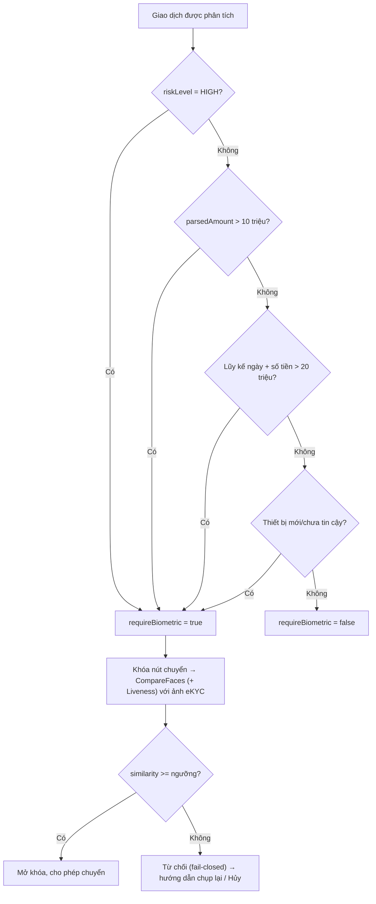

# TrustPay AI — Ma trận Tuân thủ NHNN (QĐ 2345 & TT 50/2024)

> **Phiên bản:** 1.0 · **Ngày:** 22/11/2026 · **Phạm vi:** luồng xác thực giao dịch của TrustPay AI.
> **Lưu ý pháp chế:** Tài liệu tổng hợp để phục vụ thiết kế kỹ thuật và ánh xạ tuân thủ. Bộ phận Pháp chế & Tuân thủ phải đối chiếu điều khoản gốc, phụ lục và các văn bản sửa đổi, bổ sung mới nhất trước khi vận hành thật. Mọi ngưỡng được cấu hình qua biến môi trường để cập nhật mà không phát hành lại mã nguồn.

## 1. Văn bản áp dụng

| Mã | Văn bản | Vai trò |
|---|---|---|
| QĐ 2345 | Quyết định 2345/QĐ-NHNN (18/12/2023) về giải pháp an toàn, bảo mật trong thanh toán trực tuyến & thanh toán thẻ | Nền tảng ngưỡng xác thực sinh trắc học |
| TT 50 | Thông tư 50/2024/TT-NHNN (31/12/2024) về an toàn, bảo mật cho cung cấp dịch vụ trực tuyến ngành Ngân hàng | Mở rộng cho trung gian thanh toán (ví điện tử), quản lý thiết bị/phiên |

## 2. Cấu hình ngưỡng trong hệ thống

| Tham số | Biến môi trường | Mặc định | Vị trí |
|---|---|---|---|
| Ngưỡng/lần giao dịch | `BIOMETRIC_SINGLE_TXN_THRESHOLD_VND` | 10.000.000 VNĐ | `lib/compliance/biometric-policy.ts` |
| Ngưỡng lũy kế/ngày | `BIOMETRIC_DAILY_CUMULATIVE_THRESHOLD_VND` | 20.000.000 VNĐ | `lib/compliance/biometric-policy.ts` |
| Ngưỡng độ khớp khuôn mặt | `FACE_SIMILARITY_THRESHOLD` | 90 (Prod) / 80 (Demo) | `infra/lambda/verify-face.ts` |

## 3. Ma trận truy xuất tuân thủ

| # | Yêu cầu pháp lý (diễn giải) | Nguồn | Luồng xử lý TrustPay AI | Thành phần | Yêu cầu | Trạng thái |
|---|---|---|---|---|---|---|
| C-1 | Xác thực sinh trắc học khi chuyển tiền **trên 10 triệu VNĐ/lần** | QĐ 2345 | `decideBiometric` đặt `requireBiometric=true` khi `parsedAmount > ngưỡng/lần` | `biometric-policy.ts` | A6.2 | Lib sẵn sàng · KNOWN-GAP ở route (T-2.1) |
| C-2 | Xác thực sinh trắc học khi **tổng trong ngày trên 20 triệu VNĐ** | QĐ 2345 | `decideBiometric` cộng `dailyCumulativeBefore + parsedAmount` so ngưỡng ngày | `biometric-policy.ts` + Ledger ngày (DynamoDB) | A6.4 | Lib sẵn sàng · Ledger Giai đoạn 2 (T-2.10) |
| C-3 | Giao dịch **đúng 10 triệu** không bắt buộc chỉ vì giá trị (áp dụng cho "trên" ngưỡng) | QĐ 2345 | So sánh dùng dấu **lớn hơn** (`>`), không `>=` | `biometric-policy.ts` | A6.3 | Đã đáp ứng |
| C-4 | So khớp với **dữ liệu sinh trắc học đã xác minh** của khách (eKYC) | QĐ 2345 | Production so selfie ↔ ảnh tham chiếu eKYC (S3), không so selfie với chính nó | `infra/lambda/verify-face.ts` | A7.1 | Giai đoạn 2 (T-3.4) · KNOWN-GAP Demo (G4) |
| C-5 | Chống giả mạo khuôn mặt (ảnh/màn hình/deepfake) | QĐ 2345, TT 50 | Rekognition **Face Liveness** trước so khớp | Rekognition | A7.6 | Giai đoạn 2 (T-3.4) |
| C-6 | **Ràng buộc thiết bị tin cậy**; xác thực lại khi thiết bị mới | TT 50 | `decideBiometric(isNewDevice=true)` buộc step-up; đăng ký thiết bị | `biometric-policy.ts` + Device registry | A6.5 | Lib sẵn sàng · hạ tầng Giai đoạn 2 (T-2.11) |
| C-7 | Áp dụng cho **tổ chức trung gian thanh toán** (ví điện tử) | TT 50 | Toàn bộ luồng ví áp dụng chính sách sinh trắc & cảnh báo | Toàn hệ thống | — | Đã đáp ứng (thiết kế) |
| C-8 | **Cảnh báo giao dịch bất thường**, hỗ trợ phát hiện gian lận | TT 50 | Lá Chắn AI chấm rủi ro, đẩy ticket Ops thời gian thực | `/api/analyze`, Ops | A3, B1 | Đã đáp ứng |
| C-9 | **Quản lý phiên & đăng nhập**, xác thực mạnh | TT 50 | SSO + MFA (Ops); phiên có thời hạn; `correlationId` | Hạ tầng | B5.1, X5.1 | Giai đoạn 2 (T-3.6) |
| C-10 | **Mã hóa** dữ liệu truyền & lưu trữ | TT 50 | TLS ≥ 1.2; KMS CMK cho DynamoDB/S3/env | `infra/` | X2.6 | Đã đáp ứng (IaC) |
| C-11 | **Nhật ký & lưu vết** phục vụ tra soát | TT 50 | Audit Trail bất biến (append-only), PITR, TTL | DynamoDB | B4 | Hạ tầng sẵn sàng |
| C-12 | **Giám sát, phát hiện & ứng phó sự cố** | TT 50 | CloudWatch, anomaly alarms, Runbook DR | `infra/`, `architecture/` | X5, A9 | Đã đáp ứng |
| C-13 | **Hạn chế thiết bị rủi ro** (đã bẻ khóa/root) | TT 50 | Kiểm tra tính toàn vẹn thiết bị trước giao dịch (client attestation) | Client + chính sách | — | Lộ trình (ngoài phạm vi MVP) |

## 4. Luồng quyết định step-up sinh trắc học

## 5. Bằng chứng kiểm thử & khoảng trống

| Hạng mục | Kiểm thử | Ghi chú |
|---|---|---|
| Ngưỡng > 10 triệu buộc sinh trắc (chính sách) | `tests/fraud-adversarial-suite.ts` F05 | Lib đúng; route cần áp (T-2.1) |
| Đúng 10 triệu không buộc chỉ vì giá trị | `biometric-policy.ts` dùng `>` | Đơn vị hóa trong F05 |
| Fail-closed verify-face Production | `infra/lambda/verify-face.ts` | Demo fail-open ghi nhận gap (T-2.2) |
| Cảnh báo bất thường & đẩy Ops | F01–F04, F09, F10 | Đã đáp ứng |

## 6. Khuyến nghị trước khi vận hành

1. Chốt ngưỡng với Pháp chế & cập nhật biến môi trường tương ứng.
2. Hoàn tất T-2.1, T-2.10, T-2.11 để route áp đầy đủ C-1, C-2, C-6.
3. Triển khai Rekognition Collection (eKYC) + Face Liveness cho C-4, C-5.
4. Bật SSO/MFA/RBAC cho Ops (C-9) và client attestation thiết bị (C-13).
5. Lưu trữ nhật ký theo thời hạn do NHNN/Pháp chế quy định; kiểm thử phục hồi PITR.
