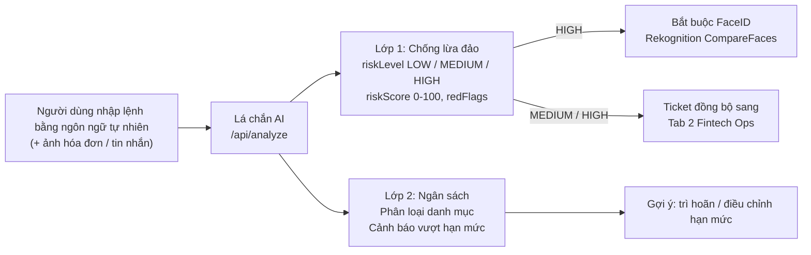
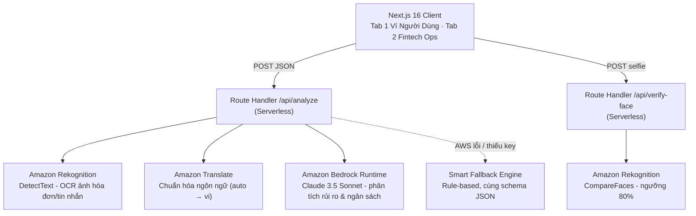
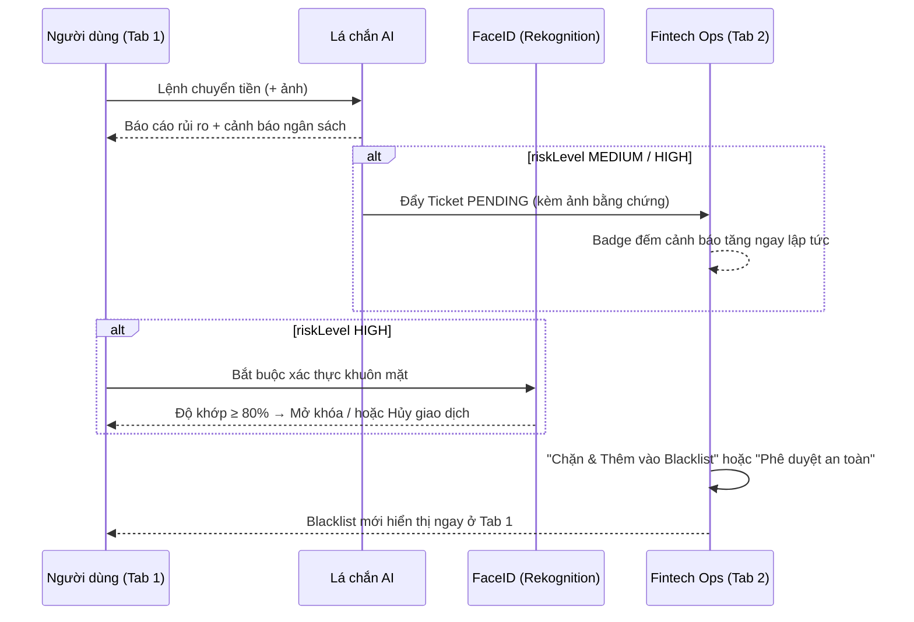

# TrustPay AI — Pitch Deck (9 Slide)

> **Sự kiện:** MoMo TechDay 2026 · **Đối tượng:** Ban Giám Khảo
> **Sản phẩm:** TrustPay AI — Ví thanh toán thông minh tích hợp Lá chắn AI chống lừa đảo thời gian thực + Fintech Future Workspace (Ops)
> **Nền tảng:** Next.js 16 (App Router) · AWS Serverless · Amazon Bedrock (Claude 3.5 Sonnet) · Amazon Rekognition · Amazon Translate

---

## Slide 1 — Trang bìa

**Tiêu đề:** TrustPay AI — Mỗi lệnh chuyển tiền đều được AI "soát vé" trước khi tiền rời ví

**Phụ đề:** Ví thông minh 2 lớp bảo vệ: Lá chắn chống lừa đảo + Kiểm soát ngân sách, đồng bộ thời gian thực với Fintech Ops Workspace.

**Hình ảnh gợi ý:** Logo khiên TrustPay (gradient tím–hồng MoMo `#a50064 → #d82d8b`) + badge "AWS Serverless Powered".

**Thông điệp mở đầu (≈15 giây):**
> "Chúng tôi không xây thêm một ví điện tử. Chúng tôi xây một lớp bảo vệ nằm *giữa* người dùng và nút 'Chuyển tiền'."

---

## Slide 2 — Vấn đề: 2 "lỗ hổng" ở khoảnh khắc chuyển tiền

| Lỗ hổng | Biểu hiện thực tế | Hệ quả |
|---|---|---|
| **1. Lừa đảo chuyển khoản** | Mạo danh công an/cán bộ điều tra yêu cầu "chuyển tiền xác minh tài khoản"; bẫy "trúng thưởng iPhone, nộp phí nhận quà"; ngôn từ thúc ép "chuyển gấp" | Người dùng tự tay chuyển tiền → rất khó thu hồi; uy tín ví bị ảnh hưởng |
| **2. Bội chi cá nhân** | Chi tiêu theo cảm xúc, không biết mình đã vượt hạn mức danh mục (Ăn uống, Mua sắm, Di chuyển, Khác) | Mất kiểm soát tài chính, giảm niềm tin vào ví |

**Điểm mấu chốt:**
- Các hệ thống hiện nay thường cảnh báo **sau** giao dịch, hoặc chỉ dựa trên luật tĩnh.
- Đội vận hành (Ops/Fraud) và người dùng **không nhìn thấy cùng một dữ liệu tại cùng một thời điểm**.

> **Câu hỏi đặt ra:** Làm sao chặn rủi ro *trước khi* tiền rời ví — mà không làm phiền 99% giao dịch bình thường?

---

## Slide 3 — Giải pháp: TrustPay AI với 2 lớp bảo vệ

**Lớp 1 — Lá chắn chống lừa đảo**
- Đối chiếu **Blacklist** (STK, tên đối tượng) thời gian thực.
- Nhận diện kịch bản: mạo danh cơ quan chức năng, phí nhận thưởng/quà tặng, thúc ép khẩn cấp.
- Trả về `riskScore`, `scamType`, danh sách `redFlags` và lời giải thích dễ hiểu.
- Rủi ro **HIGH** → khóa nút chuyển, **bắt buộc xác thực khuôn mặt**.

**Lớp 2 — Trợ lý ngân sách**
- Tự động phân loại giao dịch vào 4 danh mục.
- Tính số dư hạn mức *sau* giao dịch, cảnh báo nếu vượt và đưa ra gợi ý hành động.

**Trải nghiệm:** Gõ 1 câu tiếng Việt như nhắn tin — *"Chuyển 45.000đ tiền bún bò cho Quán Cô Ba"* — AI tự tách số tiền, người nhận, danh mục.

---

## Slide 4 — Kiến trúc AWS Serverless

| Thành phần | Vai trò trong TrustPay AI |
|---|---|
| **Amazon Bedrock – Claude 3.5 Sonnet** (`anthropic.claude-3-5-sonnet-20240620-v1:0`, temperature 0.1) | Bộ não phân tích: đọc lệnh + văn bản OCR + Blacklist + ngân sách → trả về **JSON chuẩn `TransactionAnalysisResponse`** |
| **Amazon Rekognition – DetectText** | OCR ảnh chụp hóa đơn / tin nhắn lừa đảo để AI phân tích cả bằng chứng hình ảnh |
| **Amazon Rekognition – CompareFaces** | Xác thực sinh trắc học khuôn mặt cho giao dịch rủi ro cao (`SimilarityThreshold: 80`) |
| **Amazon Translate** | Chuẩn hóa nội dung đa ngôn ngữ (`SourceLanguageCode: auto → vi`) trước khi đưa vào Bedrock |
| **Smart Fallback Engine** | Đảm bảo **luôn có phản hồi** dù AWS gián đoạn: bộ luật nhận diện số tiền (k, nghìn, triệu, 12.000.000đ), người nhận, danh mục, Blacklist, từ khóa lừa đảo |

**Điểm kỹ thuật đáng chú ý:**
- **Hợp đồng dữ liệu chặt chẽ** (`types/trustpay.ts`): mọi phản hồi AI được *merge* với baseline → UI không bao giờ vỡ vì AI trả thiếu trường.
- **Resilient by design:** lỗi OCR hay Translate không chặn luồng chính; lỗi Bedrock tự động chuyển sang Fallback.
- **Serverless:** không quản lý máy chủ, tự co giãn theo lưu lượng giao dịch.

---

## Slide 5 — Đồng bộ thời gian thực Tab 1 ⇄ Tab 2

**Một nguồn dữ liệu chung** (số dư, ngân sách, Blacklist, danh sách ticket) được chia sẻ giữa:
- **Tab 1 — Ví Người Dùng & Lá Chắn AI**
- **Tab 2 — Fintech Future Workspace (Ops)**

**Vòng lặp khép kín:** Người dùng phát hiện → AI chấm điểm → Ops xử lý → Blacklist cập nhật → giao dịch kế tiếp tới cùng đối tượng bị chặn ngay từ Lớp 1.

---

## Slide 6 — Demo thực tế: 4 kịch bản 1-click

| # | Lệnh mẫu | Kết quả Lá chắn AI | Hành động hệ thống |
|---|---|---|---|
| **1. An toàn** | "Chuyển 45.000đ tiền bún bò cho Quán Cô Ba" | **LOW** · Ăn uống · còn 1.755.000đ hạn mức | Cho phép chuyển ngay |
| **2. Vượt ngân sách** | "Thanh toán 2.500.000đ mua giày sneaker tại Shop XYZ" | **LOW** · Mua sắm · **vượt 1.000.000đ** | Nhắc nhở + gợi ý trì hoãn, vẫn cho phép |
| **3. Mạo danh & Blacklist** | "Chuyển gấp 12.000.000đ cho Cán bộ điều tra STK 999988887777 để xác minh tài khoản" | **HIGH · 95/100** · Mạo danh cơ quan công an + Blacklist + thúc ép | Khóa → **FaceID** → Ticket sang Ops |
| **4. Bẫy trúng thưởng** | "Chuyển 3.000.000đ phí nhận thưởng iPhone 16 Pro Max cho Trung tâm CSKH" | **HIGH · 88/100** · Lừa đảo đóng phí nhận thưởng | Cảnh báo đỏ → **FaceID** → Ticket sang Ops |

**Điểm nhấn khi demo:**
- Màn hình đăng nhập **1-click** — không cần mật khẩu (số dư demo 15.000.000đ).
- Hỗ trợ **tải ảnh hóa đơn / tin nhắn** (OCR Rekognition, PNG/JPG ≤ 5MB) — ảnh đi kèm ticket làm bằng chứng cho Ops.
- Nút **"Reset dữ liệu Demo"** khôi phục toàn bộ trạng thái chỉ trong 1 click.

---

## Slide 7 — Hiệu quả kinh doanh

**Giá trị cho người dùng**
- Được bảo vệ **trước** khi chuyển tiền, với lời giải thích dễ hiểu (không chỉ là "giao dịch bị từ chối").
- Kiểm soát chi tiêu theo danh mục ngay tại khoảnh khắc ra quyết định.

**Giá trị cho MoMo / đơn vị vận hành**
- **Giảm ma sát có chọn lọc:** chỉ giao dịch HIGH mới cần FaceID; giao dịch LOW đi thẳng → không ảnh hưởng tỷ lệ chuyển đổi.
- **Ops làm việc trên ticket đã được AI tóm tắt sẵn:** điểm rủi ro, loại lừa đảo, hành động đề xuất, ảnh bằng chứng → rút ngắn thời gian xử lý.
- **Blacklist tự tăng trưởng** từ chính quyết định của đội Ops → hiệu ứng mạng lưới chống lừa đảo.
- **Chi phí theo mức dùng (pay-per-use)** nhờ kiến trúc Serverless + Bedrock on-demand.

**KPI đề xuất đo lường khi pilot** *(mục tiêu, cần kiểm chứng bằng dữ liệu thật)*:

| KPI | Cách đo |
|---|---|
| Tỷ lệ giao dịch lừa đảo bị chặn trước khi chuyển | Số ticket HIGH bị BLOCKED / tổng ticket HIGH |
| Tỷ lệ báo động giả (false positive) | Ticket bị Ops "Phê duyệt an toàn" / tổng ticket |
| Thời gian xử lý trung bình một ticket Ops | Từ lúc PENDING → BLOCKED/APPROVED |
| Tỷ lệ người dùng hủy giao dịch sau cảnh báo | Số lần "Hủy giao dịch" sau báo cáo HIGH |
| Mức tuân thủ ngân sách | % danh mục không vượt hạn mức cuối tháng |

---

## Slide 8 — Khả năng mở rộng trên hệ sinh thái MoMo

| Giai đoạn | Mở rộng |
|---|---|
| **Ngắn hạn** | Tích hợp Lá chắn AI làm bước kiểm tra trước nút "Chuyển tiền" / "Thanh toán QR"; đồng bộ Blacklist với hệ thống chống gian lận hiện có |
| **Trung hạn** | Lưu ticket & Blacklist bền vững (DynamoDB / S3 – SDK `client-s3` đã sẵn sàng); thông báo đẩy cho Ops; Bedrock Guardrails & Knowledge Base về các kịch bản lừa đảo mới |
| **Dài hạn** | Mở rộng sang Ví trả sau, Vay tiêu dùng, Bảo hiểm, Đầu tư: cùng một engine chấm điểm rủi ro; hồ sơ hành vi chi tiêu cá nhân hóa ngân sách; hỗ trợ đa ngôn ngữ cho người dùng nước ngoài nhờ Amazon Translate |

**Vì sao dễ mở rộng?**
- **API contract độc lập** (`/api/analyze`, `/api/verify-face`) — bất kỳ kênh nào (app, mini-app, web) đều gọi được.
- **Model-agnostic:** đổi model qua biến môi trường `BEDROCK_MODEL_ID`.
- **Serverless:** tự co giãn theo các đợt cao điểm (Tết, sale 11.11, cuối tháng).

---

## Slide 9 — Kết luận & Lời kêu gọi

**TrustPay AI = Lá chắn chống lừa đảo + Trợ lý ngân sách + Workspace cho Ops, trong cùng một luồng thời gian thực.**

- ✅ Chặn rủi ro **trước** khi tiền rời ví.
- ✅ Chỉ làm phiền đúng giao dịch nguy hiểm (FaceID cho HIGH).
- ✅ Người dùng và Ops nhìn thấy **cùng một sự thật** tại cùng một thời điểm.
- ✅ Chạy trên AWS Serverless, luôn có phản hồi nhờ Smart Fallback.

**Lời kêu gọi:**
> "Hãy để TrustPay AI trở thành 'người gác cổng' cho mỗi giao dịch trên MoMo — mời Ban Giám Khảo trải nghiệm ngay với 1 click đăng nhập và 4 kịch bản demo."

**Tài liệu kèm theo:** `docs/USER_GUIDE_A4.md` · `docs/DEMO_VIDEO_SCRIPT.md`
