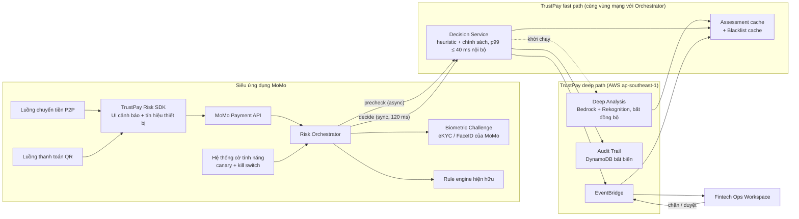
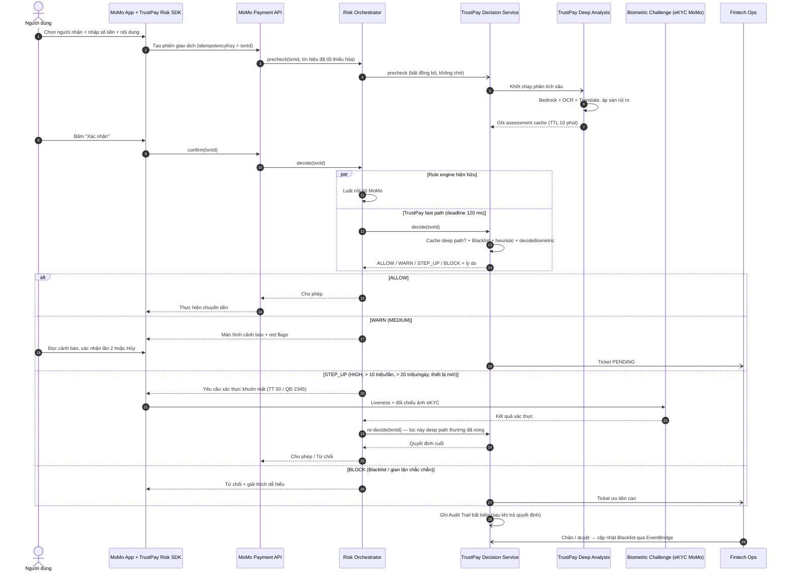
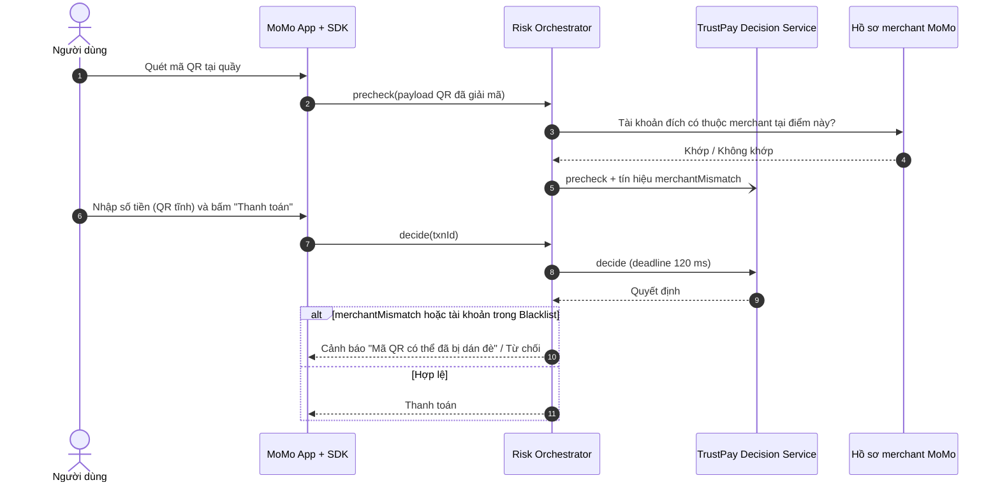

# TrustPay AI — Tích hợp vào Siêu ứng dụng MoMo (P2P & Thanh toán QR)

> **Phiên bản:** 1.0 · **Ngày:** 22/11/2026 · **Đối tượng:** CTO, kiến trúc sư Payment/Risk, đội SRE của MoMo.
> **Giả định:** các thành phần phía MoMo (MoMo App, Payment API, Risk Orchestrator, dịch vụ eKYC/FaceID, rule engine hiện hữu, hệ thống cờ tính năng) được mô tả theo mô hình chuẩn của một ví điện tử. Tên gọi và ranh giới cần đối chiếu với kiến trúc thực tế của MoMo trong buổi làm việc kỹ thuật.
> **Ràng buộc bất biến:** không thay đổi hợp đồng `types/trustpay.ts` / `API_CONTRACT.md`. Lớp adapter phía Risk Orchestrator ánh xạ `TransactionAnalysisResponse` sang quyết định nội bộ của MoMo.

---

## 1. Bài toán tích hợp

| Yêu cầu | Giá trị mục tiêu |
|---|---|
| Ngân sách độ trễ cho quyết định rủi ro trong luồng xác nhận | **p99 ≤ 150 ms** (Risk Orchestrator ↔ TrustPay, phía máy chủ) |
| Luồng áp dụng | Chuyển tiền P2P (số điện thoại, số tài khoản ngân hàng) và thanh toán QR (VietQR/EMVCo, QR merchant) |
| Tuân thủ | Step-up sinh trắc học theo QĐ 2345/QĐ-NHNN và TT 50/2024/TT-NHNN (trên 10 triệu VNĐ/lần, trên 20 triệu VNĐ/ngày, thiết bị mới, rủi ro cao) |
| Tác động tới trải nghiệm | Không thêm bước nào cho giao dịch rủi ro thấp |

**Mâu thuẫn cốt lõi:** lời gọi Amazon Bedrock (Claude 3.5 Sonnet) có p95 khoảng 2,5 giây (REQ-X4.1), lớn hơn ngân sách 150 ms khoảng 16 lần. Vì vậy **LLM không được nằm trên đường găng của nút "Xác nhận"**.

**Quyết định kiến trúc (ADR-7):** tách TrustPay AI thành 2 đường:

| Đường | Thành phần | Thời điểm chạy | Độ trễ |
|---|---|---|---|
| **Deep path (bất đồng bộ)** | Bedrock + Rekognition DetectText + Translate | Ngay khi người dùng nhập xong người nhận/số tiền hoặc quét QR, **trước** khi bấm "Xác nhận" | 1–4 giây, ẩn sau thời gian người dùng đọc lại màn hình xác nhận |
| **Fast path (đồng bộ)** | Decision Service: Offline Heuristic Engine + Blacklist cache + chính sách sinh trắc học + kết quả deep path nếu đã sẵn sàng | Khi người dùng bấm "Xác nhận" | p99 ≤ 150 ms toàn chặng |

Người dùng thường mất vài giây để đọc lại màn hình xác nhận (con số này cần đo bằng dữ liệu hành vi thật của MoMo). Khoảng thời gian đó đủ để deep path hoàn tất ở phần lớn giao dịch. Khi deep path chưa xong, fast path vẫn đưa ra phán quyết an toàn bằng bộ luật xác định; kết quả deep path đến muộn được dùng để hậu kiểm và tạo ticket Ops.

---

## 2. Kiến trúc tích hợp tổng thể



### 2.1 Phân vai trách nhiệm

| Thành phần | Chủ sở hữu | Trách nhiệm | Không làm |
|---|---|---|---|
| TrustPay Risk SDK (trong MoMo App) | TrustPay + MoMo Mobile | Hiển thị cảnh báo rủi ro, red flags, lời khuyên; thu tín hiệu thiết bị (device ID đã băm, cờ root/jailbreak) | Không tự quyết định cho/chặn giao dịch; không gọi AWS trực tiếp; không giữ khóa bí mật |
| MoMo Payment API | MoMo | Tạo phiên giao dịch, idempotency key, gọi Risk Orchestrator | Không gọi TrustPay trực tiếp |
| Risk Orchestrator | MoMo Risk | Gom tín hiệu từ rule engine hiện hữu + TrustPay; áp chính sách cuối; kích hoạt Biometric Challenge; quản lý canary và kill switch | Không gửi PII thô sang TrustPay |
| Decision Service (fast path) | TrustPay | Trả phán quyết trong ngân sách thời gian bằng heuristic + cache + chính sách sinh trắc học | Không gọi LLM đồng bộ |
| Deep Analysis (deep path) | TrustPay | Bedrock, OCR ảnh, Translate; ghi kết quả vào assessment cache; áp sàn rủi ro (`safeMergeAnalysis`) | Không chặn luồng thanh toán |
| Biometric Challenge | MoMo eKYC | Đối chiếu khuôn mặt với ảnh eKYC đã xác minh, liveness | — |
| Fintech Ops Workspace | MoMo Fraud Ops | Xử lý ticket MEDIUM/HIGH, chặn và cập nhật Blacklist | — |

---

## 3. Ngân sách độ trễ (Latency Budget) — fast path ≤ 150 ms

### 3.1 Đặt Decision Service gần Risk Orchestrator

Offline Heuristic Engine, chính sách sinh trắc học (`lib/compliance/biometric-policy.ts`) và Blacklist cache là **mã thuần CPU, không phụ thuộc dịch vụ AI của AWS**. Vì vậy Decision Service có thể chạy dạng container ngay trong cùng vùng mạng với Risk Orchestrator, còn deep path (Bedrock, Rekognition) chạy ở `ap-southeast-1`.

Nếu Orchestrator đặt tại Việt Nam mà gọi Decision Service ở Singapore, mỗi chiều mạng sẽ tốn thêm vài chục mili-giây (cần đo RTT thực tế giữa hai trung tâm dữ liệu). Phương án đặt cùng vùng mạng loại bỏ chi phí này khỏi đường găng.

### 3.2 Phân bổ ngân sách từng chặng

| # | Chặng (đường găng khi bấm "Xác nhận") | p50 mục tiêu | p99 mục tiêu | Ghi chú |
|---|---|---|---|---|
| 1 | Payment API → Risk Orchestrator | 2 ms | 5 ms | Cùng cụm |
| 2 | Orchestrator → Decision Service (mTLS, keep-alive) | 2 ms | 8 ms | Cùng vùng mạng |
| 3 | Đọc assessment cache (kết quả deep path, khóa = mã phiên giao dịch) | 1 ms | 5 ms | Redis/DAX trong vùng |
| 4 | Tra Blacklist | < 1 ms | 1 ms | Bộ nhớ trong + Bloom filter, nạp lại qua EventBridge |
| 5 | Offline Heuristic Engine | < 1 ms | 5 ms | Thuần CPU, đo bằng `npm run test:bench` |
| 6 | Ledger ngày + `decideBiometric` | 2 ms | 10 ms | Đọc 1 bản ghi `USER#…/DAILY#yyyymmdd` |
| 7 | Decision Service → Orchestrator | 2 ms | 8 ms | |
| 8 | Orchestrator hợp nhất với rule engine hiện hữu (chạy song song từ chặng 2) | 2 ms | 10 ms | |
| | **Cộng dồn (cận trên bảo thủ)** | **≈ 12 ms** | **≈ 52 ms** | p99 từng chặng không cộng tuyến tính; cộng dồn là ước lượng an toàn |
| | **Dự phòng còn lại** | | **≈ 98 ms** | Hấp thụ GC pause, nhiễu mạng, đột biến tải |

Ghi Audit Trail và phát sự kiện EventBridge chạy **sau** khi đã trả quyết định, không nằm trên đường găng.

### 3.3 Quy tắc giữ ngân sách

1. **Deadline cứng 120 ms** cho lời gọi Orchestrator → Decision Service; truyền deadline qua header `x-trustpay-deadline-ms` để Decision Service tự cắt bớt việc khi sắp hết giờ.
2. **Không retry trên đường găng.** Retry nuốt ngân sách; khi quá hạn, Orchestrator áp ma trận Fail-Open/Fail-Closed (mục 5).
3. **Hedged request (tùy chọn):** vì quyết định là thao tác chỉ đọc và idempotent, Orchestrator có thể gửi yêu cầu thứ hai tới replica khác sau 60 ms nếu chưa có phản hồi, nhận kết quả về trước.
4. **Không gọi LLM đồng bộ.** Bedrock chỉ chạy ở deep path, timeout 4.000 ms, Rekognition 2.500 ms, Translate 1.500 ms (theo `.kiro/steering/fintech-architecture-guardrails.md`).
5. **Provisioned Concurrency / số replica tối thiểu** cho Decision Service để loại cold start khỏi p99.

### 3.4 Thời điểm kích hoạt deep path

| Luồng | Sự kiện kích hoạt `precheck` | Dữ liệu gửi sang |
|---|---|---|
| P2P | Người dùng đã chọn người nhận **và** nhập số tiền (debounce 300 ms), trước màn hình xác nhận | Số tiền, người nhận (theo chính sách dữ liệu mục 9), nội dung chuyển khoản |
| QR | Ngay sau khi giải mã payload VietQR/EMVCo | Tài khoản/merchant trong payload, số tiền (nếu QR động), kết quả đối chiếu merchant đã đăng ký |
| Ảnh hóa đơn/tin nhắn | Người dùng chủ động đính kèm trong luồng "kiểm tra giúp tôi" | Ảnh qua S3 presigned URL (không đi qua đường găng) |

Nếu deep path chưa xong khi người dùng bấm "Xác nhận", fast path ra quyết định bằng bộ luật. Với các quyết định `STEP_UP`, thời gian người dùng thực hiện xác thực khuôn mặt (vài giây) thường đủ để deep path hoàn tất; Orchestrator **tính lại quyết định** sau khi xác thực xong (mục 4).

---

## 4. Sơ đồ tuần tự

### 4.1 Chuyển tiền P2P: MoMo App → Risk Orchestrator → TrustPay AI → Biometric Challenge



### 4.2 Thanh toán QR

Khác biệt chính so với P2P:

| Bước | Xử lý riêng cho QR |
|---|---|
| Giải mã | SDK giải mã payload VietQR/EMVCo; gửi tài khoản đích và tên hiển thị trong payload sang `precheck` |
| Đối chiếu merchant | Orchestrator so tài khoản đích với hồ sơ merchant đã đăng ký tại điểm bán. **Không khớp** (dấu hiệu QR dán đè) ⇒ tối thiểu `WARN`, kèm red flag "Tài khoản nhận không thuộc cửa hàng đã đăng ký" |
| QR tĩnh của merchant đã xác minh, số tiền nhỏ | Ưu tiên `ALLOW` để không làm chậm hàng đợi thanh toán |
| QR cá nhân nhận số tiền lớn | Áp đầy đủ chính sách sinh trắc học như P2P |



---

## 5. Cơ chế Fail-Open / Fail-Closed

### 5.1 Nguyên tắc

1. **TrustPay AI không được trở thành điểm lỗi đơn lẻ của luồng thanh toán MoMo.** Khi TrustPay lỗi hoặc quá hạn, giao dịch rủi ro thấp vẫn đi tiếp theo rule engine hiện hữu (fail-open có kiểm soát).
2. **Nghĩa vụ pháp lý không phụ thuộc TrustPay.** Ngưỡng sinh trắc học của QĐ 2345 / TT 50 được Risk Orchestrator áp **cục bộ**, kể cả khi TrustPay vắng mặt. TrustPay chỉ bổ sung lý do step-up (rủi ro AI), không phải nguồn duy nhất của quyết định tuân thủ.
3. **Blacklist có bản sao cục bộ** tại Orchestrator (đồng bộ qua EventBridge), nên trúng Blacklist vẫn bị chặn khi TrustPay mất kết nối.
4. **Xác thực khuôn mặt lỗi thì fail-closed** đối với giao dịch thuộc diện bắt buộc sinh trắc học.

### 5.2 Ma trận quyết định khi TrustPay lỗi, quá hạn 120 ms, hoặc Circuit Breaker phía Orchestrator đang mở

| Bối cảnh giao dịch | Hành vi | Chế độ |
|---|---|---|
| ≤ 10 triệu, người nhận đã giao dịch trước, thiết bị tin cậy | Cho phép theo rule engine hiện hữu | **Fail-open** |
| ≤ 10 triệu, người nhận mới | Cho phép kèm cảnh báo chung "Hãy kiểm tra kỹ người nhận" trên SDK | **Fail-open có cảnh báo** |
| > 10 triệu/lần, hoặc lũy kế > 20 triệu/ngày, hoặc thiết bị mới | Bắt buộc xác thực khuôn mặt (Orchestrator tự áp ngưỡng) | **Fail-safe step-up** |
| Trúng Blacklist cục bộ | Từ chối | **Fail-closed** |
| QR không khớp merchant đã đăng ký | Cảnh báo bắt buộc đọc trước khi thanh toán | **Fail-safe warn** |
| Dịch vụ xác thực khuôn mặt lỗi với giao dịch thuộc diện bắt buộc | Tạm dừng giao dịch, hướng dẫn thử lại sau; không hạ cấp xuống OTP nếu Pháp chế chưa phê duyệt kênh thay thế | **Fail-closed** |
| Deep path lỗi nhưng fast path hoạt động | Quyết định bằng heuristic; ghi chỉ số `deep_path_unavailable` | Suy giảm duyên dáng |

### 5.3 Circuit Breaker phía Orchestrator

| Tham số | Giá trị khởi điểm (tinh chỉnh khi pilot) |
|---|---|
| Mở mạch | Tỷ lệ lỗi hoặc quá hạn > 5% trong cửa sổ 60 giây (tối thiểu 200 yêu cầu) |
| Thời gian mở | 30 giây, sau đó HALF_OPEN với 1% lưu lượng thử |
| Khi mở | Áp ma trận 5.2, không gọi TrustPay |
| Kill switch | Cờ `trustpay.enforcement.enabled = false` tắt toàn bộ ảnh hưởng của TrustPay trong < 1 phút, không cần triển khai lại |

Mẫu breaker 3 trạng thái tương ứng đã có trong `lib/resilience/circuit-breaker.ts` và được kiểm chứng ở kịch bản F14 của `tests/fraud-adversarial-suite.ts`.

---

## 6. Adapter hợp đồng dữ liệu (giữ nguyên `types/trustpay.ts`)

### 6.1 Ánh xạ phản hồi sang quyết định của Orchestrator

| Tín hiệu trong `TransactionAnalysisResponse` | Quyết định Orchestrator | Hiển thị trên SDK |
|---|---|---|
| `scamReport.riskLevel = "LOW"` và `requireBiometric = false` | `ALLOW` | Không hiển thị gì thêm |
| `scamReport.riskLevel = "MEDIUM"` | `WARN` | Thẻ cảnh báo vàng + `redFlags` + `explanation`, yêu cầu xác nhận lần 2 |
| `requireBiometric = true` hoặc `scamReport.riskLevel = "HIGH"` | `STEP_UP` | Cảnh báo đỏ + màn hình xác thực khuôn mặt của MoMo |
| Người nhận trúng Blacklist của MoMo (bất kể điểm rủi ro) | `BLOCK` | Giải thích lý do bằng tiếng Việt dễ hiểu |
| `budgetAlert.isExceeded = true` | Không ảnh hưởng quyết định | Gợi ý ngân sách (chỉ khi người dùng đã bật tính năng ngân sách) |
| `fintechOpsTicket` (khi MEDIUM/HIGH) | Đẩy hàng đợi Fraud Ops qua EventBridge | — |

### 6.2 Phác thảo adapter (TypeScript, minh họa)

```ts
import type {
  TransactionAnalysisRequest,
  TransactionAnalysisResponse,
} from "@/types/trustpay";

type OrchestratorDecision = "ALLOW" | "WARN" | "STEP_UP" | "BLOCK";

interface MomoTransferContext {
  amountVnd: number;
  recipientDisplayName: string;
  recipientAccountRef: string; // tham chiếu nội bộ, không phải số CCCD
  memo: string;
  isBlacklistedLocally: boolean;
}

export function toTrustPayRequest(ctx: MomoTransferContext): TransactionAnalysisRequest {
  return {
    // Hợp đồng v1 nhận lệnh dạng văn bản: adapter dựng câu lệnh từ trường có cấu trúc.
    commandText: `Chuyển ${ctx.amountVnd}đ cho ${ctx.recipientDisplayName} STK ${ctx.recipientAccountRef} nội dung ${ctx.memo}`,
    currentBudgets: [],
    blacklist: [],
  };
}

export function toDecision(
  res: TransactionAnalysisResponse,
  ctx: MomoTransferContext,
): OrchestratorDecision {
  // Blacklist cục bộ của MoMo luôn thắng, kể cả khi TrustPay chấm rủi ro thấp.
  if (ctx.isBlacklistedLocally) return "BLOCK";
  // Ngưỡng QĐ 2345 / TT 50 được Orchestrator áp riêng bằng decideBiometric();
  // tín hiệu dưới đây chỉ bổ sung lý do step-up từ phía AI.
  if (res.requireBiometric || res.scamReport.riskLevel === "HIGH") return "STEP_UP";
  if (res.scamReport.riskLevel === "MEDIUM") return "WARN";
  return "ALLOW";
}
```

**Ghi chú về hợp đồng v1 khi tích hợp:**

- Route hiện tại dùng `DEFAULT_BUDGETS` / `DEFAULT_BLACKLIST` (dữ liệu demo) khi `currentBudgets` / `blacklist` rỗng. Trước pilot, Decision Service phải đọc **Blacklist phía máy chủ** (REQ-X2.5, task T-4.2) và bỏ qua `budgetAlert` khi người dùng chưa bật tính năng ngân sách.
- `HIGH` được ánh xạ sang `STEP_UP` thay vì `BLOCK`: người dùng vẫn được cảnh báo và có thể tự hủy, còn quyết định chặn cứng thuộc về Blacklist và Fraud Ops. Cách này giảm tác hại của báo động giả.
- Các trường có cấu trúc (mã tham chiếu người nhận, cờ merchant mismatch, tín hiệu thiết bị) cần **hợp đồng v2 có phiên bản** theo quy trình review hợp đồng (REQ-X1.2). Tài liệu này không thay đổi hợp đồng v1.


---

## 7. Kế hoạch Canary Rollout (1% → 10% → 100%)

### 7.1 Cách phân nhóm

- **Gán cố định theo người dùng:** `bucket = hash(userId + salt) mod 10.000`; nhóm canary là các bucket `< ngưỡng`. Một người dùng luôn ở cùng nhóm, tránh trải nghiệm lúc có lúc không.
- **Nhóm đối chứng cùng kích thước** chạy rule engine hiện hữu, để so sánh tỷ lệ thiệt hại do lừa đảo và tỷ lệ hoàn tất giao dịch.
- **Loại trừ ở giai đoạn đầu:** merchant lưu lượng lớn, tài khoản doanh nghiệp, luồng giải ngân tự động.
- Toàn bộ điều khiển qua hệ thống cờ tính năng của MoMo; không cần phát hành lại ứng dụng.

### 7.2 Các giai đoạn

| Giai đoạn | Lưu lượng | Phạm vi | Thời gian tối thiểu | Ảnh hưởng người dùng |
|---|---|---|---|---|
| **0. Shadow (khuyến nghị trước canary)** | 100% bản sao bất đồng bộ | P2P + QR | 14 ngày | Không: TrustPay chỉ ghi quyết định, Orchestrator bỏ qua |
| **1. Canary 1%** | 1% người dùng | P2P, ưu tiên nhân viên nội bộ trước | 7 ngày | `WARN` và `STEP_UP` có hiệu lực; `BLOCK` chỉ từ Blacklist |
| **2. Canary 10%** | 10% người dùng | P2P + QR | 14 ngày | Đầy đủ quyết định |
| **3. General Availability 100%** | 100% (có thể chèn bước 25% / 50% nếu chỉ số dao động) | P2P + QR | — | Đầy đủ quyết định |

Giai đoạn Shadow trả lời câu hỏi "TrustPay sẽ quyết định khác rule engine hiện hữu ở đâu" mà không tạo rủi ro cho người dùng; dữ liệu này dùng để tinh chỉnh ngưỡng trước khi canary.

### 7.3 Tiêu chí chuyển giai đoạn

Mọi ngưỡng dưới đây là giá trị khởi điểm đề xuất, cần MoMo chốt theo dữ liệu nền hiện có.

| Chỉ số | Điều kiện để đi tiếp |
|---|---|
| p99 quyết định fast path | ≤ 150 ms suốt giai đoạn |
| Tỷ lệ lỗi Decision Service | < 0,1% |
| Tỷ lệ fallback (breaker mở hoặc quá hạn) | < 2% |
| Tỷ lệ deep path xong trước khi bấm "Xác nhận" | Theo dõi, mục tiêu ≥ 80% |
| Tỷ lệ báo động giả (ticket bị Ops "Phê duyệt an toàn" / tổng ticket) | Không cao hơn mức nền của rule engine hiện hữu |
| Tỷ lệ hoàn tất giao dịch so với nhóm đối chứng | Giảm không quá 0,2 điểm phần trăm |
| Khiếu nại liên quan cảnh báo | Không tăng có ý nghĩa thống kê |
| Thiệt hại do lừa đảo trên 1 triệu giao dịch | Thấp hơn nhóm đối chứng (đánh giá ở giai đoạn 2, cần đủ cỡ mẫu) |

### 7.4 Tự động quay lui (Rollback)

| Điều kiện kích hoạt | Hành động | Thời gian |
|---|---|---|
| p99 > 150 ms liên tục 10 phút | Hạ về giai đoạn trước | < 1 phút qua cờ tính năng |
| Tỷ lệ lỗi > 1% trong 5 phút | Bật kill switch `trustpay.enforcement.enabled = false` | < 1 phút |
| Tỷ lệ hoàn tất giảm > 0,5 điểm phần trăm so với đối chứng trong 1 giờ | Hạ về giai đoạn trước, mở điều tra | < 1 phút |
| Sự cố bảo mật hoặc dữ liệu cá nhân | Kill switch + quy trình ứng phó (thông báo trong 72 giờ theo NĐ 13 nếu có vi phạm) | Ngay lập tức |

Quay lui chỉ tắt **ảnh hưởng** của TrustPay; ngưỡng sinh trắc học theo pháp luật vẫn do Orchestrator áp như trước khi tích hợp.

---

## 8. SLO & quan sát

| SLO | Mục tiêu | Metric (namespace `TrustPayAI`) |
|---|---|---|
| Độ sẵn sàng Decision Service | 99,95% / tháng | `DecisionAvailability` |
| Độ trễ fast path | p99 ≤ 150 ms (toàn chặng), p99 ≤ 40 ms (nội bộ Decision Service) | `DecisionLatency` |
| Deep path sẵn sàng trước khi xác nhận | ≥ 80% | `DeepPathReadyRatio` |
| Tỷ lệ fallback | < 2% | `FallbackRate` |
| Tỷ lệ step-up | Theo dõi xu hướng theo luồng P2P/QR | `StepUpRate` |
| Tỷ lệ báo động giả | Không cao hơn mức nền | `FalsePositiveRate` |

- **Truy vết:** mã phiên giao dịch của MoMo đi xuyên suốt dưới dạng `x-correlation-id` qua Payment API → Orchestrator → Decision Service → Deep Analysis → EventBridge → Audit Trail (REQ-X5.1).
- **Dashboard & cảnh báo:** mở rộng `infra/lib/observability-finops-stack.ts` với các metric trên; cảnh báo trực ca khi vi phạm điều kiện rollback.

---

## 9. Bảo mật & tuân thủ khi tích hợp

| Chủ đề | Thiết kế |
|---|---|
| **Mô hình triển khai** | TrustPay chạy single-tenant trong **AWS account của MoMo** (hoặc account con trong AWS Organization của MoMo). MoMo giữ vai trò bên kiểm soát dữ liệu, dữ liệu không chuyển cho bên thứ ba |
| **Kết nối** | AWS PrivateLink (VPC Endpoint Service) giữa VPC của Orchestrator và Decision Service; mTLS; không có endpoint công khai |
| **Xác thực dịch vụ** | IAM (SigV4) hoặc chứng chỉ client mTLS gắn với danh tính dịch vụ Orchestrator; xoay vòng chứng chỉ tự động |
| **Chống replay** | `idempotencyKey = txnId` của MoMo, ghi `IDEMP#<txnId>` với TTL; yêu cầu quá cửa sổ thời gian hợp lệ bị loại |
| **Tối thiểu hóa dữ liệu (NĐ 13)** | Không gửi số CCCD, ảnh khuôn mặt, số điện thoại đầy đủ. Nội dung chuyển khoản đi qua `maskPiiInText` trước khi vào prompt Bedrock |
| **Sinh trắc học** | Do hệ thống eKYC/FaceID hiện hữu của MoMo thực hiện (liveness + đối chiếu ảnh eKYC). TrustPay **không** lưu ảnh khuôn mặt trong mô hình tích hợp |
| **Lưu trú dữ liệu** | Deep path ở `ap-southeast-1`; hồ sơ chuyển dữ liệu xuyên biên giới theo `compliance/decree-13-dpia-report.md` mục 7 |
| **Nhật ký** | Audit Trail bất biến (chỉ `PutItem`), mã hóa KMS CMK, PITR; chỉ lưu dữ liệu đã che và băm SHA-256 của nội dung lệnh |
| **Ngưỡng pháp lý** | 10 triệu VNĐ/lần và 20 triệu VNĐ/ngày cấu hình bằng biến môi trường, áp tại Orchestrator; mọi thay đổi đi qua hook `biometric-threshold-audit` và phê duyệt của Pháp chế |

Ánh xạ điều khoản chi tiết: `compliance/nhnn-circular-50-decision-2345-matrix.md`.

---

## 10. Điều kiện tiên quyết trước Shadow & Canary

Các hạng mục dưới đây đã được ghi trong `.kiro/specs/trustpay-ai/tasks.md` và phải hoàn tất trước khi TrustPay ảnh hưởng tới giao dịch thật:

| Task | Nội dung | Lý do bắt buộc |
|---|---|---|
| T-2.1 | Áp `biometric-policy` trong route phân tích | Giao dịch rủi ro thấp trên 10 triệu phải được step-up |
| T-2.3 | Áp sàn rủi ro `safeMergeAnalysis` khi trộn kết quả Bedrock | Chống prompt injection hạ điểm rủi ro |
| T-2.6 | Bọc lời gọi AWS bằng Circuit Breaker + timeout | Giữ deep path trong ngân sách thời gian |
| T-2.7 | Che CCCD trong `recipient` / `summary` / prompt | Tuân thủ NĐ 13 |
| T-2.9 | Chuẩn hóa Unicode trước khi dò từ khóa | Chống né từ khóa bằng ký tự ẩn |
| T-2.10 | Ledger ngày phía máy chủ | Ngưỡng 20 triệu VNĐ/ngày |
| T-4.2 | Blacklist phía máy chủ + cache | Không dùng `DEFAULT_BLACKLIST` demo trong Production |
| Mới | Tách Decision Service (fast path) khỏi Deep Analysis, thêm assessment cache theo `txnId` | Đạt ngân sách 150 ms |

Bộ kiểm thử `npm run test:fraud -- --strict` phải đạt 0 `KNOWN-GAP` trước giai đoạn Canary 1%.

---

## 11. Câu hỏi cần thống nhất với MoMo

1. Risk Orchestrator hiện đặt ở đâu (trung tâm dữ liệu tại Việt Nam hay AWS region nào)? RTT thực tế tới `ap-southeast-1` là bao nhiêu?
2. Ngân sách 150 ms tính từ điểm nào tới điểm nào trong luồng của MoMo, và hiện rule engine đang dùng bao nhiêu trong số đó?
3. Thời gian trung vị người dùng dừng ở màn hình xác nhận P2P và QR là bao lâu? (quyết định tỷ lệ deep path kịp hoàn tất)
4. Hệ thống cờ tính năng và cơ chế phân nhóm người dùng hiện có hỗ trợ gán cố định theo `userId` không?
5. Kênh xác thực thay thế khi eKYC/FaceID gián đoạn đã được Pháp chế phê duyệt chưa?
6. Với chuyển tiền ví-tới-ví nội bộ MoMo, có cơ chế tạm giữ phía nhận khi kết quả deep path đến muộn và cho thấy rủi ro cao không? (cần Pháp chế đánh giá)
7. Định dạng và nguồn sự thật của Blacklist hiện hữu, tần suất đồng bộ mong muốn?
